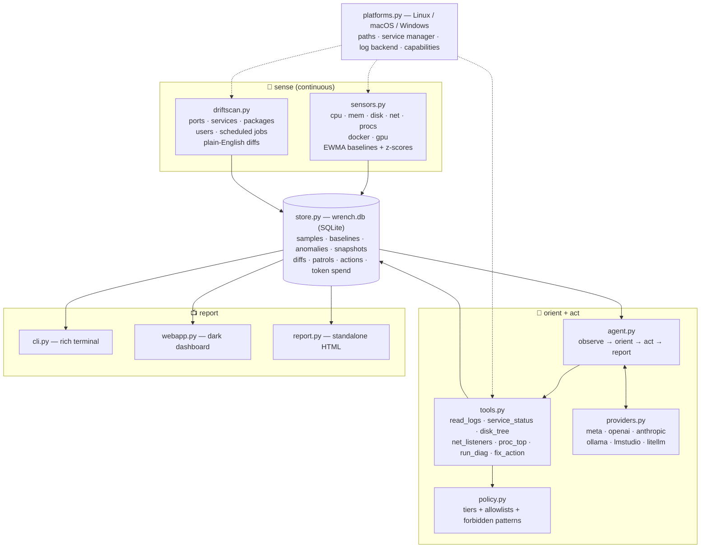

# 🔧 wrench

> **An AI sysadmin that lives on your machine: it continuously senses, remembers the history, explains problems in plain English — and asks before touching anything.**

[](LICENSE)
[](pyproject.toml)
[](PLATFORMS.md)
[](#the-brain-is-swappable)
[](#policy-tiers--the-leash)
[](https://sunkencity999.github.io/wrench/)

## The problem nobody is watching

Your machine degrades slowly, and silently. A disk creeps from 60% to 94%
over three months. A service dies at 3 a.m. and nothing notices. A package
upgrade quietly changes a config. A port opens that you don't remember
opening. None of it pages you — until the day something actually breaks, and
then you're doing archaeology: scrolling logs, diffing configs from memory,
trying to reconstruct *what changed and when* from scraps.

The standard tools each solve a slice of this and leave the rest to you:

- `top`, `df`, `ps` show you **right now**, with no memory of last Tuesday.
- Logs remember everything and prioritize nothing.
- Monitoring stacks (Prometheus/Grafana) can watch trends — after you define
  the metrics, build the dashboards, tune the alerts, and run the stack. Great
  for fleets. Overkill for the one box you actually love.
- And none of them can *investigate*. A graph can scream; it can't find out why.

**wrench** closes the loop. It's a single `pip install` that puts a tireless
staff sysadmin on the box itself. It does four things, continuously:

| | | |
|---|---|---|
| 📡 | **Sense** | Samples CPU, memory, swap, disks, network, processes, Docker, and GPU into a local SQLite time-series. Learns what "normal" looks like per metric (EWMA baselines) and flags statistical anomalies (z-scores) — not arbitrary thresholds. |
| 🧠 | **Remember** | Snapshots what the machine *is* — listening ports, running services, installed packages, user accounts, scheduled jobs — and diffs every scan into plain-English change history: "port opened: tcp/8081 (python3)", "package upgraded: openssl 3.0.13". When something breaks, the timeline already exists. |
| 💬 | **Explain** | An LLM agent with read-only diagnostic tools answers questions about *your* machine, grounded in its actual telemetry and logs — not generic trivia. "Why is my disk filling up?" gets investigated, not guessed at. |
| 🚓 | **Patrol** | On a schedule, wrench reviews the sensors, the anomalies, and the drift; investigates anything suspicious with real diagnostics; and files a report a human wants to read. Ok / attention / critical, findings with evidence, exact commands to fix. |

All of it runs locally. The telemetry never leaves the box unless *you* point
the brain at a cloud model — and you can point it at [Ollama](https://ollama.com)
instead and keep everything in the house.

### `wrench status` — the one-glance answer to "are we okay?"


### `wrench ask` — diagnosis grounded in real telemetry


*Both GIFs are real, lightly-sanitized recordings from the dev box. In the
second one, wrench runs eight read-only diagnostics on its own, figures out
that 37 GiB of "used" swap is cold history rather than live memory pressure,
and closes with: "With 109 Gi swap, 33% is coffee, not fire."*

## 60-second quickstart

**Linux**

```bash
curl -fsSL https://raw.githubusercontent.com/sunkencity999/wrench/main/scripts/install.sh | bash
# or: pipx install git+https://github.com/sunkencity999/wrench
```

**macOS**

```bash
# needs python 3.10+ (brew install python if you don't have it)
curl -fsSL https://raw.githubusercontent.com/sunkencity999/wrench/main/scripts/install.sh | bash
```

**Windows (PowerShell)**

```powershell
irm https://raw.githubusercontent.com/sunkencity999/wrench/main/scripts/install.ps1 | iex
```

Then, on any OS:

```bash
wrench init                 # write config + record first baselines
export META_API_KEY=...     # or OPENAI_API_KEY / ANTHROPIC_API_KEY / nothing for ollama
wrench doctor               # verify sensors, platform capabilities, provider liveness
wrench status               # one-screen health
wrench patrol               # send it on its rounds
wrench web                  # dark dashboard at http://127.0.0.1:8787
wrench install-service      # patrol on a schedule: systemd / launchd / Task Scheduler
```

No API key? Everything except the agent still works — `status`, `watch`,
`drift`, and the dashboard are pure local telemetry. And if you run
[Ollama](https://ollama.com), the whole brain is local too:
`wrench patrol -p ollama -m llama3.1`.

> **Platform honesty:** Linux is tested end-to-end on real hardware. The macOS
> and Windows paths are implemented behind a platform abstraction with
> unit-tested branches, and need native smoke tests — details in
> [PLATFORMS.md](PLATFORMS.md). If you try wrench on a Mac or Windows box,
> please open an issue with your `wrench doctor` output.

## The CLI, command by command

Every command below is real output from the dev box (hostnames and paths
sanitized). Click to expand.

### `wrench status`

One screen: gauges with 24h sparklines, every mount, load, network rates, GPU,
Docker, and any anomalies against learned baselines.

<details>
<summary>example output</summary>

```text
╭────────────────────────── 🔧 wrench status ──────────────────────────╮
│                                                                      │
│             CPU  █░░░░░░░░░░░░░░░░░   5.8%   █▅▆▄▅▁▂▂▆▂▁▂▄▁▁▁▁▁▁▁▁▂  │
│             MEM  ████░░░░░░░░░░░░░░  24.5%   ▂▄▂▁▇▇▇▇█▁▁▂▂▁▁▁▁▁▁▁▁▁  │
│            SWAP  █████░░░░░░░░░░░░░  33.2%                           │
│          disk /  ███████░░░░░░░░░░░  43.7%                           │
│  disk /mnt/tank  █████████░░░░░░░░░  52.8%                           │
│  disk /mnt/nvme  █████████░░░░░░░░░  51.7%                           │
│                                                                      │
│  load 0.63 / 0.77 / 1.26   procs 683   up 223h   net ↓179 ↑72 KB/s   │
│  gpu NVIDIA RTX PRO 6000: 0% util, 96375/97887 MB, 33°C              │
│  docker: 5/8 containers running                                      │
│  no anomalies in 24h — baselines quiet                               │
│                                                                      │
╰────────────────────────── 2026-11-04 01:23:02 ───────────────────────╯
```
</details>

### `wrench ask "…"`

One question, investigated. The agent gets a read-only toolbelt (logs, process
tables, sockets, disk trees, allowlisted diagnostics) and must cite evidence.

<details>
<summary>example: "which disk will fill up first, and what's the biggest hog on it?"</summary>

```text
$ wrench ask "which disk will fill up first, and what's the biggest hog on it?"
  ⚙ run_diag {"command": "df -h"}
  ⚙ disk_tree {"path": "/mnt/tank", "depth": 1}
  ⚙ disk_tree {"path": "/home/user/storage", "depth": 1}
  ⚙ disk_tree {"path": "/", "depth": 1}
╭──────────────────────────────── 🔧 wrench ────────────────────────────────╮
│  1. Most likely to fill first: /home/user/storage (/dev/sdb)              │
│   • df -h: 1.8T size, 1019G used, 722G avail, 59% use                     │
│   • highest use% and the smallest headroom — at equal write rates         │
│     it hits 100% first.                                                   │
│                                                                           │
│  2. Biggest hog on it? du only accounts for ~42G of 1019G. du stderr      │
│     names the suspect: 'backups/borg-system': Permission denied.          │
│     The real hog is almost certainly in root-owned backups, or            │
│     deleted-but-open files.                                               │
│                                                                           │
│  To confirm (suggest tier — run as human):                                │
│   sudo du -xhd1 /home/user/storage 2>&1 | sort -hr                        │
│   sudo lsof +L1 | grep -E 'storage|deleted'                               │
╰───────────────────────────────────────────────────────────────────────────╯
```

Note what happened there: it didn't guess, it measured; it noticed the du/df
discrepancy; and because it's in the default **suggest** tier, it handed the
privileged commands to the human instead of running them.
</details>

### `wrench drift`

"What changed on this box?" — the question behind 90% of debugging sessions.

<details>
<summary>example output</summary>

```text
$ wrench drift
╭────────────────────────── 🔧 wrench drift ──────────────────────────╮
│ ports                                                               │
│   • port opened: tcp/8790 (python3)                                 │
│ packages                                                            │
│   • package upgraded: openssl 3.0.13-0ubuntu3.6                     │
│   • package installed: mailutils                                    │
│ services                                                            │
│   • service stopped: user:comfy-local.service                       │
╰─────────────────────────────────────────────────────────────────────╯
```

First run records the baseline; every run after that is a diff. `--narrate`
adds a model's risk assessment of the changes. Snapshots cover listening
ports, running services, installed packages, user accounts, and scheduled
jobs (cron / LaunchAgents / Scheduled Tasks, per OS).
</details>

### `wrench patrol`

The heart of wrench — see [the next section](#how-a-patrol-works).

### `wrench explain <service | :port | PID | /path>`

Point at a thing, get a briefing: what it is, whether it's healthy, whether it
should be there.

<details>
<summary>example: <code>wrench explain :8787</code></summary>

```text
$ wrench explain :8787
  ⚙ net_listeners {}
  ⚙ run_diag {"command": "ps aux"}
╭──────────────────────────────── 🔧 wrench ────────────────────────────────╮
│  tcp/8787 is a python3 process — wrench's own web dashboard               │
│  (wrench/webapp.py), bound to 127.0.0.1 only. Loopback-bound, so          │
│  it is not exposed to the network. Healthy and expected.                  │
╰───────────────────────────────────────────────────────────────────────────╯
```
</details>

### `wrench chat`

The same agent, conversational — for incidents with plot twists. It keeps
context across turns, so "what about the other disk?" works.

### `wrench watch`

Foreground patrol loop (`--interval` seconds) for when you want a live
terminal sentinel instead of a scheduled service.

### `wrench report` / `wrench web`

`report` lists recent patrols with status and token cost. `web` serves the
dark dashboard — live vitals, 24h SVG timelines, patrol feed, drift feed,
agent action log, token-spend widget — all rendered from the same SQLite file,
zero build step, zero CDN.


### `wrench init` / `wrench doctor` / `wrench install-service`

Onboarding, self-diagnosis, and persistence. `doctor` checks config, store,
sensors, platform capabilities (which service manager? which log backend?),
and provider liveness. `install-service` schedules patrols natively on every
OS:

| OS | mechanism |
|---|---|
| Linux | user systemd service + timer |
| macOS | launchd user agent (`~/Library/LaunchAgents`) |
| Windows | Scheduled Task (`schtasks`) |

`wrench install-service --uninstall` removes it just as cleanly.

## How a patrol works

A patrol is the full loop — **observe → orient → act → report** — run end to
end:

1. **Observe.** Sample every sensor. Scan for drift. Pull anomalies from the
   last six hours of baselines.
2. **Orient.** Hand the model a compact telemetry briefing: vitals, disk
   pressure, top processes, container states, anomaly list, drift changes.
3. **Act.** The agent investigates anything suspicious using its toolbelt —
   read logs, check failed units, walk disk trees, list sockets — every call
   policy-checked, time-bounded, and logged. In the default tier it cannot
   mutate anything.
4. **Report.** A structured verdict: `ok` / `attention` / `critical`, findings
   with severity and evidence, and exact recommended commands. Rendered in
   the terminal, as a styled standalone HTML file, and as a row in the
   dashboard's patrol feed.

### The night it earned its keep

This is a real patrol report from wrench's first day of existence, running on
the dev box (full sanitized HTML in [`examples/`](examples/)):

> **⚠ ATTENTION** — Machine is functional under heavy GPU load, but /dev/sda
> has unreadable pending sectors, memory is tight, and one user service
> failed.
>
> - **[high]** /dev/sda failing-disk warning: smartd reports "7 currently
>   unreadable (pending) sectors" every 30 min all day; /dev/sda1 is a 5.5T
>   data mount at 53% — **2.8T of data at risk**
> - **[medium]** memory pressure explained: 92.3% RAM; an image-generation
>   process holds 48 GB RSS at 198% CPU
> - **[medium]** repeated PCIe AER errors from one root port, six times today —
>   downstream device needs identification
> - **[low]** SMART alerts go nowhere: smartd-runner fails because
>   `/usr/bin/mail` is missing — **the disk warnings were never delivered**
>
> recommendations: back up the at-risk mount now; `sudo smartctl -a /dev/sda`;
> install mailutils so SMART alerts actually reach a human; `lspci -s 80:1c.4
> -vv` to identify the AER source.

That's the pitch in one report. The machine had been complaining into the void
every thirty minutes *all day* — a failing disk, with the alert pipeline
itself broken, so no human would ever have heard. wrench read the journal,
connected smartd's warnings to the mount and its contents, noticed the
missing mailer, and said: back up now, here's the exact command, and here's
why you never got the email. A metric dashboard shows you a line going up. A
patrol tells you *the disk is dying, the alarm was broken, and here is what
to do about it.*

## The brain is swappable

```bash
wrench patrol                          # Meta Muse (default): muse-spark-1.3
wrench patrol --deep                   # muse-wonder-1.0 for the hard cases
wrench ask -p ollama -m llama3.1 "…"   # fully local, nothing leaves the box
wrench ask -p openai "…"               # or OpenAI
wrench ask -p anthropic "…"            # or Anthropic (native adapter)
wrench ask -p lmstudio "…"             # or LM Studio
wrench ask -p litellm "…"              # or anything behind a LiteLLM proxy
```

One agent loop, six doors. Tool calling uses a strict JSON protocol instead of
provider-specific function-calling APIs, so every backend — including small
local models — drives the same tools.

Setup per provider:

<details>
<summary>Meta (default)</summary>

```bash
export META_API_KEY=...        # or api_key_file in config
wrench init -p meta && wrench doctor
```
Models: `muse-spark-1.3` (fast, agentic — patrols and asks) and
`muse-wonder-1.0` (deep reasoning — `--deep`). Both are reasoning models:
wrench budgets `max_tokens = 6144` by default because they think before they
speak; don't starve them below ~2000.
</details>

<details>
<summary>OpenAI / Anthropic</summary>

```bash
export OPENAI_API_KEY=...      # gpt-4o-mini default, gpt-4o for --deep
wrench init -p openai

export ANTHROPIC_API_KEY=...   # claude-3-5-haiku default; native messages API adapter
wrench init -p anthropic
```
</details>

<details>
<summary>Ollama / LM Studio / LiteLLM (local & proxy)</summary>

```bash
wrench init -p ollama          # http://127.0.0.1:11434/v1, no key needed
wrench ask -p ollama -m llama3.1 "why is my disk filling up?"

wrench init -p lmstudio        # http://127.0.0.1:1234/v1
wrench init -p litellm         # http://127.0.0.1:4000/v1 — any model behind the proxy
```
Base URLs and models are overridable in `config.toml` or via
`WRENCH_BASE_URL` / `WRENCH_MODEL` env vars.
</details>

Keys come from env (`META_API_KEY`, `OPENAI_API_KEY`, …) or an `api_key_file`
path in the config; they are never logged, and never stored in the database.

## Policy tiers — the leash

An agent that can touch your system needs a leash you control. wrench's whole
permission model is one line in the config:

| tier | may look | may suggest | may execute fixes |
|---|---|---|---|
| `observe` | ✅ | ❌ | ❌ |
| `suggest` *(default)* | ✅ | ✅ | ❌ |
| `repair` | ✅ | ✅ | ✅ allowlisted, **with confirmation** |
| `autonomous` | ✅ | ✅ | ✅ allowlisted, unattended |

The execution layer is no-shell (`shlex` → argv — no pipes, no chaining, no
interpolation), the repair allowlist is deliberately tiny (service lifecycle,
journal vacuum), a forbidden-pattern list hard-blocks the scary stuff
(`rm`, `dd`, `mkfs`, `format C:`, `diskpart`, `csrutil`, …) at **every** tier,
and every action — allowed, denied, or declined — is logged to the actions
table and shown in the dashboard. Diagnostics are a separate, read-only,
per-OS allowlist.

## Architecture



Everything lands in one SQLite file. The dashboard, the terminal, and the HTML
reports all render from the same store the agent writes to — there is exactly
one source of truth, and you can query it with any sqlite client.

Data locations (override with `WRENCH_DATA_DIR` / `WRENCH_CONFIG_DIR`):

| OS | config | data |
|---|---|---|
| Linux | `~/.config/wrench/` | `~/.local/share/wrench/` |
| macOS | `~/Library/Application Support/wrench/` | same |
| Windows | `%APPDATA%\wrench\` | `%LOCALAPPDATA%\wrench\` |

## Philosophy

- Read-only by default. Touching things is a privilege, not a personality trait.
- Evidence over vibes. Every claim cites a metric, a log line, or a diff.
- Every action is logged. If wrench did it, there's a receipt.
- Ask first, act second. Surprises are for birthdays, not production boxes.
- Local first. Your telemetry lives in SQLite on your machine; the model provider is your choice.
- Degrade gracefully. Missing binary? Reduced capability and an honest note — never a crash.
- If it doesn't know, it says so. A confident hallucination is just lying with formatting.

## FAQ

**Will it `rm -rf` my server?**
No. wrench starts in `suggest`, where it physically cannot mutate anything.
Every tier above that is gated by allowlists and confirmation, the
forbidden-pattern list blocks destructive commands at every tier, and
everything is logged. The only way it touches your system unsupervised is if
you deliberately promote it to `autonomous` *and* the action is on the
allowlist. It's an agent with a leash and a paperwork habit.

**Why not just cron + bash?**
Cron is great at running a script at 4 a.m. and emailing you a cryptic
failure. It has no memory, no baseline for what's normal, and no ability to
investigate. wrench adds continuous telemetry, drift history, and an agent
that connects "disk at 94%" to "this container, since Tuesday, here's the
log." Keep your bash scripts — wrench just writes the incident report they'd
never write.

**Does my data leave the machine?**
Your telemetry stays in a local SQLite database on the box. If you use a cloud
LLM provider, the relevant context is sent there for diagnosis — that's how
cloud models work. If you'd rather nothing leave the house, point wrench at
Ollama or LM Studio and run the whole brain locally. Your box, your call.

**Does it really run on macOS and Windows?**
Yes, with honesty about maturity: core sensing is psutil-based and identical
everywhere; services, logs, packages, and scheduling go through a platform
layer (journald/systemd ↔ unified log/launchd ↔ Event Log/schtasks). Linux is
tested end-to-end on real hardware; the macOS/Windows branches are
implemented and unit-tested with mocks, pending native smoke tests. The full
tested-vs-implemented matrix lives in [PLATFORMS.md](PLATFORMS.md).

**What if the LLM gets it wrong?**
That's exactly why the policy tiers exist. wrench must cite evidence from real
diagnostics, its investigations are read-only, and in the lower tiers it can
only *propose* — you approve. A wrong suggestion costs you ten seconds of
reading. A wrong autonomous action is prevented by the allowlist you control.

**Do I need an LLM at all?**
No. Sensors, `status`, `watch` sampling, `drift`, and the dashboard work fine
with no model configured — you get solid telemetry and change detection. The
LLM is what turns that data into investigations, explanations, and reports
instead of homework.

**Isn't this just Prometheus + Grafana?**
Those are excellent tools for fleets and dashboards. wrench is for one beloved
machine (or a few), with zero-config local storage, drift tracking, and an
agent that doesn't just show you a graph screaming — it goes and finds out
*why* it's screaming, then explains it in English.

**How much does it cost to run?**
Sensing and drift are free (local CPU, negligible). Patrols cost tokens:
with the default fast model, a patrol on the dev box runs tens of thousands of
tokens — pennies on cloud providers, free on Ollama. The dashboard has a
token-spend widget so the cost is never a mystery.

## Built for the Meta hackathon

wrench was built for the Meta Llama hackathon (2026) and uses Meta's Muse
models as its default brain. Parts of this README's humor were drafted by
`muse-wonder-1.0`, which makes it possibly the first README that is also a
demo artifact.

## License

MIT — see [LICENSE](LICENSE).

---

*wrench — MIT-licensed, locally nosy, and it knocks before it touches anything.*
