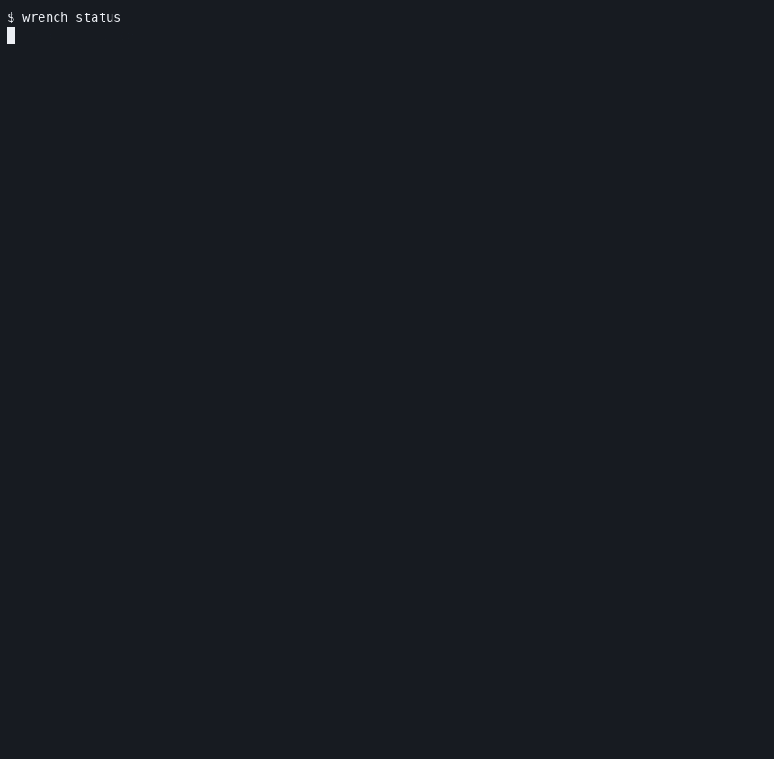

# 🔧 wrench

> **Your machine's staff sysadmin. Never sleeps. Asks before touching anything.**

[](LICENSE)
[](pyproject.toml)
[](#the-brain-is-swappable)
[](#policy-tiers--the-leash)
[](https://sunkencity999.github.io/wrench/)

Every homelab has that one box: it runs twelve things, you built it three years
ago, and if it dies, so does your weekend. **wrench lives on that box.** It
samples CPU, memory, disk, network, Docker, and GPU into a local SQLite
time-series, learns what "normal" looks like, notices what changed, and — when
something smells off — investigates with read-only diagnostics and files a
report you'll actually want to read. It's a staff sysadmin, minus the salary
and the 3 a.m. pager resentment.



## Quickstart

```bash
pipx install git+https://github.com/sunkencity999/wrench

wrench init                 # config + first baselines
export META_API_KEY=...     # or OPENAI_API_KEY / ANTHROPIC_API_KEY / nothing for ollama
wrench doctor               # verify sensors + provider
wrench status               # one-screen health
wrench patrol               # send it on its rounds
wrench web                  # the dark dashboard, http://127.0.0.1:8787
```

No API key? No problem — sensors, `status`, `watch`, and `drift` work with no
model configured. Point it at [Ollama](https://ollama.com) and the whole brain
runs locally: `wrench patrol -p ollama -m llama3.1`.

## Why

- **Pets, not cattle.** Cloud servers get culled and replaced. Your box has a
  name, hand-tuned configs, and a mysterious directory from 2022 that
  everything secretly depends on. wrench treats it accordingly: it remembers
  its history, tracks its drift, and explains what changed instead of
  suggesting you nuke and pave.
- **Your homelab deserves a staff engineer.** Right now you're the SRE, the
  help desk, and the person who notices the disk filled up — usually too late.
  wrench does the boring rounds for you: watching trends, catching disk creep,
  dead containers, and ports nobody remembers opening.
- **LLMs are good at diagnosis when given real telemetry.** An LLM guessing
  from a single pasted error message is astrology with better grammar. Fed
  weeks of sensor history, EWMA anomaly baselines, drift snapshots, and actual
  logs, it can do real correlation work — like noticing your disk filled up
  because one container started logging like it was being paid per line.
- **Trust is earned through policy tiers.** wrench starts in `observe` (look,
  don't touch), graduates to `suggest` (propose fixes), then `repair` (act on
  allowlisted fixes, with confirmation), and only reaches `autonomous` for
  chores you've explicitly approved. It gets promoted when you say so, not
  when it feels confident.

## What a patrol looks like

```text
$ wrench patrol
  ⚙ run_diag {"command": "systemctl --user list-units --state=failed"}
  ⚙ read_logs {"unit": "smartd", "lines": 60}
  ⚙ proc_top {"sort": "mem"}
  ⚙ net_listeners {}
╭──────────────────────────── 🔧 wrench patrol ─────────────────────────────╮
│  ▲ ATTENTION   Box is healthy overall, but the disk at /dev/sda is       │
│  reporting 7 pending sectors and one user timer failed overnight.        │
│                                                                          │
│   [warning] smartd: 7 currently unreadable (pending) sectors on          │
│             /dev/sda (journal, 08:01)                                    │
│   [info] library-index-refresh.service exited 1 — embed backend          │
│          returned 500 at 03:42; timer will retry                         │
│   [info] disk pressure OK: / 43.7%, /srv 52.8%                           │
│                                                                          │
│  recommendations:                                                        │
│    $ sudo smartctl -a /dev/sda                                           │
│    $ journalctl --user -u library-index-refresh.service -n 100           │
│                                                                          │
│  investigated with 4 tool call(s) · muse-spark-1.3 · 31k tokens · 74s    │
╰──────────────────────────────────────────────────────────────────────────╯
```

Real patrol reports from the dev box live in [`examples/`](examples/) — every
one also lands as a styled, self-contained [HTML report](examples/) and a row
in the dashboard's patrol feed.

## Commands

| command | what it does |
|---|---|
| `wrench status` | The one-glance answer to "are we okay?" Health gauges, sparklines, and anomalies — without doomscrolling through `top`, `htop`, and `df -h`. |
| `wrench ask "…"` | Ask "why is load spiking?" and get an answer grounded in your machine's actual telemetry, not generic Linux trivia. |
| `wrench chat` | A running conversation for incidents with plot twists. Interrogate the box together; wrench keeps the context. |
| `wrench patrol` | Send wrench on its rounds. It checks anomalies, runs allowlisted read-only diagnostics, follows the evidence, and files a report. `--deep` brings the big reasoning model. |
| `wrench watch` | Continuous mode: patrol every N seconds, keep building baselines, speak up when "normal" quietly stops being normal. |
| `wrench drift` | "What changed on this box?" Snapshots ports, services, packages, users, and cron, then diffs them in plain English. Essential for crimes committed by past-you. `--narrate` lets the model assess the risk. |
| `wrench explain <thing>` | Point it at a service, `:port`, PID, or path. It tells you what it is, whether it matters, and what to check next — in human. |
| `wrench report` | Recent patrols at a glance, plus paths to the styled HTML reports. |
| `wrench web` | The gorgeous dark dashboard: live vitals, 24h timelines, drift feed, patrol feed, action log, token spend. Same facts, better lighting. |
| `wrench init` | First-day onboarding: write the config, record first baselines, point at a provider. |
| `wrench install-service` | Make wrench stick around: a user systemd service + timer that patrols on schedule, surviving reboots. |
| `wrench doctor` | wrench checks itself: config, store, sensors, provider liveness. Physician, heal thyself — automated. |

## The brain is swappable

```bash
wrench patrol                          # Meta Muse (default): muse-spark-1.3
wrench patrol --deep                   # muse-wonder-1.0 for the hard cases
wrench ask -p ollama -m llama3.1 "…"   # fully local, nothing leaves the box
wrench ask -p openai "…"               # or OpenAI
wrench ask -p anthropic "…"            # or Anthropic (native adapter)
wrench ask -p lmstudio "…"             # or LM Studio
wrench ask -p litellm "…"              # or anything behind a LiteLLM proxy
```

One agent loop, six doors. Tool calling uses a strict JSON protocol instead of
provider-specific function-calling APIs, so every backend — including small
local models — drives the same tools. Keys come from env (`META_API_KEY`,
`OPENAI_API_KEY`, …) or an `api_key_file` in the config; they're never logged.

## Policy tiers — the leash

| tier | may look | may suggest | may execute fixes |
|---|---|---|---|
| `observe` | ✅ | ❌ | ❌ |
| `suggest` *(default)* | ✅ | ✅ | ❌ |
| `repair` | ✅ | ✅ | ✅ allowlisted, **with confirmation** |
| `autonomous` | ✅ | ✅ | ✅ allowlisted, unattended |

The execution layer is no-shell (`shlex` → argv, no pipes, no chaining), the
repair allowlist is deliberately tiny (service lifecycle, journal vacuum), a
forbidden-pattern list hard-blocks the scary stuff at every tier, and **every
action — allowed, denied, or declined — is logged** to the actions table and
shown in the dashboard. Diagnostics are a separate, read-only allowlist.

## Architecture

```
            ┌───────────── the intentional loop ─────────────┐
            │  observe        orient         act      report │
            ▼                                                │
  sensors.py ──┐                                             │
  (os/docker/  │   sqlite    agent.py ── tools.py ── policy.py
   gpu, EWMA   ├─▶ store.py ◀─ (LLM tool  (run_diag,  (tiers +
   baselines,  │   wrench.db   loop via    read_logs,  allowlists)
   z-scores)   │               providers)  fix_action)
  driftscan.py ┘                  │                          │
  (ports/svcs/pkgs/               ▼                          ▼
   users/cron diffs)        providers.py              report.py / webapp.py
                            meta│openai│anthropic     (rich terminal, HTML
                            ollama│lmstudio│litellm    reports, dark dashboard)
```

Everything lands in one SQLite file (`~/.local/share/wrench/wrench.db`):
samples, baselines, anomalies, snapshots, diffs, patrols, actions, and token
spend. The dashboard and the HTML reports are rendered from the same store the
agent reads.

## Philosophy

- Read-only by default. Touching things is a privilege, not a personality trait.
- Evidence over vibes. Every claim cites a metric, a log line, or a diff.
- Every action is logged. If wrench did it, there's a receipt.
- Ask first, act second. Surprises are for birthdays, not production boxes.
- Local first. Your telemetry lives in SQLite on your machine; the model provider is your choice.
- Plain English over panic. A calm explanation beats a wall of red text.
- If it doesn't know, it says so. A confident hallucination is just lying with formatting.

## FAQ

**Will it `rm -rf` my server?**
No. wrench starts in `suggest`, where it physically cannot mutate anything.
Every tier above that is gated by allowlists and confirmation, and everything
it does is logged. The only way it touches your system unsupervised is if you
deliberately promote it to `autonomous` *and* the action is on the allowlist.
It's an agent with a leash and a paperwork habit.

**Why not just cron + bash?**
Cron is great at running a script at 4 a.m. and emailing you a cryptic
failure. It has no memory, no baseline for what's normal, and no ability to
investigate. wrench adds continuous telemetry, drift history, and an agent
that connects "disk at 94%" to "this container, since Tuesday, here's the
log." Keep your bash scripts — wrench just writes the incident report they'd
never write.

**Does my data leave the machine?**
Your telemetry stays in a local SQLite database on the box. If you use a cloud
LLM provider, the relevant context gets sent there for diagnosis — that's how
cloud models work. If you'd rather nothing leave the house, point wrench at
Ollama or LM Studio and run the whole brain locally. Your box, your call.

**Which LLM does it use?**
Whichever you want. Meta Muse models are the default (`muse-spark-1.3` for
patrols, `muse-wonder-1.0` for `--deep`), but wrench is provider-agnostic:
OpenAI, Anthropic, Ollama, LM Studio, and LiteLLM all work. Swap providers
without retraining your staff.

**What if the LLM gets it wrong?**
That's exactly why the policy tiers exist. wrench must cite evidence from real
diagnostics, its investigations are read-only, and in the lower tiers it can
only *propose* — you approve. A wrong suggestion costs you ten seconds of
reading. A wrong autonomous action is prevented by the allowlist you control.

**Will it fix things on its own?**
Only if you ask it to, in writing, twice. `repair` lets it apply allowlisted
fixes with your confirmation; `autonomous` handles pre-approved chores solo.
Everyone starts as an intern here. Nobody gets root and a pep talk on day one.

**Do I need an LLM at all?**
No. Sensors, `status`, `watch` sampling, and `drift` work fine with no model
configured — you'll get solid telemetry and change detection. The LLM is what
turns that data into investigations, explanations, and reports instead of
homework.

**Isn't this just Prometheus + Grafana?**
Those are excellent tools for fleets and dashboards. wrench is for one beloved
machine (or a few), with zero-config local storage, drift tracking, and an
agent that doesn't just show you a graph screaming — it goes and finds out
*why* it's screaming, then explains it in English.

## Heritage

wrench is the lovechild of two earlier tools: **Mechanic** (continuous sensor
sampling → sqlite time-series with EWMA anomaly baselines) and **Drift**
(system snapshots → plain-English "what changed on this box" diffs) — with an
LLM agent brain bolted on top and a policy engine bolted on top of *that*.

Built for the Meta Llama hackathon, 2026. The README's jokes were drafted by
`muse-wonder-1.0`, which makes this possibly the first README that is also a
demo artifact.

## License

MIT — see [LICENSE](LICENSE).

---

*wrench — MIT-licensed, locally nosy, and it knocks before it touches anything.*
