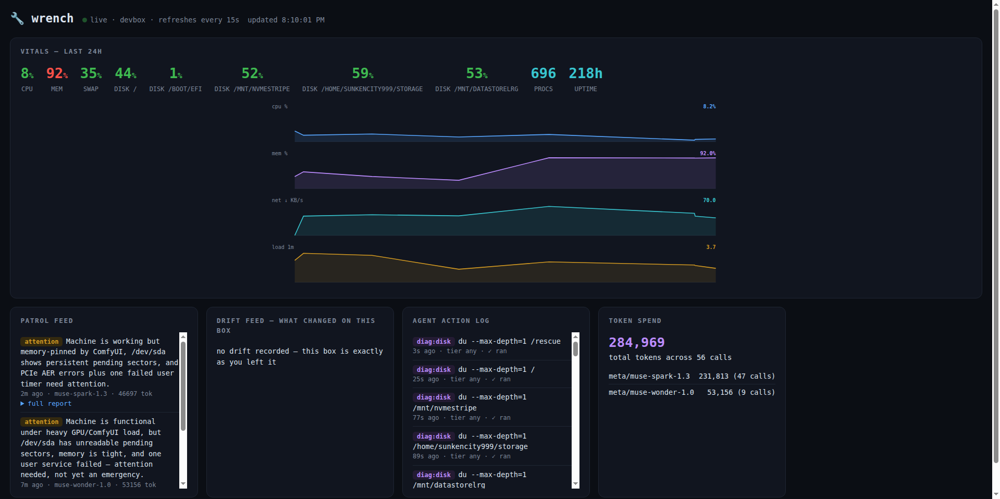

# 🔧 wrench

> **"I'm the sysadmin that lives on your machine. I read the logs so you don't have to. I remember what changed. I explain problems in plain English — and with your permission, I fix them before you ever see them."**
>
> wrench is an **intentional sysadmin agent**: **senses** (live sensors + a SQLite time-series) + **memory** (learned baselines, drift snapshots, a hash-chained audit trail) + a **bring-your-own-mind brain** + **consent-gated hands**. It **sees** the box, **predicts** what's coming, **proves** what happened, **fixes** what it can — with your permission — and **scales** to a fleet.
>
> 🧠 **Bring your own mind.** Run wrench on a **fully local brain** ([Ollama](https://ollama.com) or LM Studio — private, free, nothing leaves the box) or on **any API brain** (OpenAI, Anthropic, Meta, Azure, LiteLLM, or any OpenAI-compatible endpoint via the `custom` provider). One agent loop, many doors, no favorites.

[](LICENSE)
[](pyproject.toml)
[](PLATFORMS.md)
[](#the-brain-is-swappable)
[](#policy-tiers--the-leash)
[](https://sunkencity999.github.io/wrench/)

## The problem nobody is watching

Your machine degrades slowly, and silently. A disk creeps from 60% to 94%
over three months. A service dies at 3 a.m. and nothing notices. A package
upgrade quietly changes a config. A port opens that you don't remember
opening. None of it pages you — until the day something actually breaks, and
then you're doing archaeology: scrolling logs, diffing configs from memory,
trying to reconstruct *what changed and when* from scraps.

The standard tools each solve a slice of this and leave the rest to you:

- `top`, `df`, `ps` show you **right now**, with no memory of last Tuesday.
- Logs remember everything and prioritize nothing.
- Monitoring stacks (Prometheus/Grafana) can watch trends — after you define
  the metrics, build the dashboards, tune the alerts, and run the stack. Great
  for fleets. Overkill for the one box you actually love.
- And none of them can *investigate*. A graph can scream; it can't find out why.

**wrench** closes the loop. It's a single `pip install` that puts a tireless
staff sysadmin on the box itself. It does four things, continuously:

| | | |
|---|---|---|
| 📡 | **Sense** | Samples CPU, memory, swap, disks, network, processes, Docker, and GPU into a local SQLite time-series. Learns what "normal" looks like per metric (EWMA baselines) and flags statistical anomalies (z-scores) — not arbitrary thresholds. |
| 🧠 | **Remember** | Snapshots what the machine *is* — listening ports, running services, installed packages, user accounts, scheduled jobs — and diffs every scan into plain-English change history: "port opened: tcp/8081 (python3)", "package upgraded: openssl 3.0.13". When something breaks, the timeline already exists. |
| 💬 | **Explain** | An LLM agent with read-only diagnostic tools answers questions about *your* machine, grounded in its actual telemetry and logs — not generic trivia. "Why is my disk filling up?" gets investigated, not guessed at. |
| 🚓 | **Patrol** | On a schedule, wrench reviews the sensors, the anomalies, and the drift; investigates anything suspicious with real diagnostics; and files a report a human wants to read. Ok / attention / critical, findings with evidence, exact commands to fix. |
| 🔧 | **Fix** | `wrench fixxer` finds what's programmatically correctable — pending updates (incl. security), orphaned packages & old kernels, fat journald logs, bloated caches, stale `/tmp`, failed services — and applies the fixes you pick, with per-fix verification. Every fix is a hand-written catalog command; the model explains and helps you choose, but **never writes the shell**. Opt-in auto mode for self-healing boxes, behind a consent ceremony and an audit log. |
| 🔔 | **Notify** | When a patrol finds something worth your attention, wrench taps you on the shoulder: a desktop notification, an optional webhook (ntfy / Slack / Discord), a toast on the live dashboard, and a `🔔` banner on your next CLI command. Severity-thresholded, best-effort, never breaks a patrol. |
| 🛰️ | **Watch the horizon** | `wrench cve` checks installed packages against **[OSV.dev](https://osv.dev)** and the OS/kernel/runtimes against **[endoflife.date](https://endoflife.date)** — free public APIs, no keys. Known CVEs flow into patrols, the dashboard, and `fixxer` (which can apply *targeted* security updates for exactly the affected packages). Results cache locally with a TTL; patrols never fail because the internet is down. |

All of it runs locally, and **the brain is yours to choose**: point wrench at
[Ollama](https://ollama.com) or LM Studio and the whole agent — telemetry,
reasoning, everything — stays in the house, free; or plug in any API provider
(OpenAI, Anthropic, Meta, Azure, LiteLLM) when you want a bigger mind on the
case. Your telemetry never leaves the box unless *you* point the brain at a
cloud model.

### `wrench status` — the one-glance answer to "are we okay?"


### `wrench ask` — diagnosis grounded in real telemetry


*Both GIFs are real, lightly-sanitized recordings from the dev box. In the
second one, wrench runs eight read-only diagnostics on its own, figures out
that 37 GiB of "used" swap is cold history rather than live memory pressure,
and closes with: "With 109 Gi swap, 33% is coffee, not fire."*

## The capability map — SEE · PREDICT · PROVE · FIX · SCALE

wrench is an intentional sysadmin agent: **senses** (live sensors + a SQLite
time-series), **memory** (learned baselines, drift snapshots, a hash-chained
audit trail), a **bring-your-own-mind brain** (any OpenAI-compatible endpoint —
local or API), and **consent-gated hands** (fixxer, blueprints, cert renewal).
Everything it can do falls into five arcs. Every row below is a real command on
main today — click through to its section.

**👁 SEE — watch the box, right now** *(read-only; never touches the machine)*

| command | what it does |
|---|---|
| [`wrench status`](#wrench-status) | one-screen health: gauges, sparklines, mounts, GPU, Docker, anomalies vs learned baselines |
| [`wrench ask "…"`](#wrench-ask-) | LLM diagnosis grounded in *your* telemetry, running real read-only diagnostics |
| [`wrench patrol`](#wrench-patrol) | the full observe→orient→act→report loop; files a report a human wants to read |
| [`wrench drift`](#wrench-drift) | plain-English change history: ports, services, packages, users, cron |
| [`wrench explain`](#wrench-explain-service--port--pid--path) | investigate a service / `:port` / PID / path with grounded diagnostics |
| [`wrench security`](#wrench-security--watch-the-doors) | auth-log anomalies, new sudoers/authorized_keys, listener ownership |

**🔭 PREDICT — see it coming**

| command | what it does |
|---|---|
| [`wrench forecast`](#wrench-forecast--see-the-incident-coming) | trends disk / inode / memory / log growth into a "future incidents" feed |
| [`wrench certs`](#wrench-certs--ssltls-lifecycle-from-inventory-to-renewal) | TLS inventory + expiry ladder (30d→14d→7d) and weak-config audit |
| [`wrench cve`](#wrench-cve--what-the-internet-already-knows-about-your-box) | OSV.dev CVE matches + endoflife.date EOL checks (free APIs, cached) |

**🧾 PROVE — evidence, not vibes**

| command | what it does |
|---|---|
| [`wrench audit`](#wrench-audit--prove-what-happened) | append-only hash-chained log of every ceremony/consent/apply; `audit verify` |
| [`wrench backups`](#wrench-backups--untested-backups-dont-exist) | detect borg/restic/rsync/pg_dump jobs, confirm they actually ran |
| [`wrench drift`](#wrench-drift) baselines | labeled drift snapshots are the before/after proof for every change |

**🔧 FIX — with your permission** *(consent-gated, policy-tiered, auto-rollback)*

| command | what it does |
|---|---|
| [`wrench fixxer`](#wrench-fixxer--with-your-permission-i-fix-it) | applies hand-written catalog fixes you pick, per-fix verified; opt-in auto mode |
| [`wrench blueprint`](#wrench-blueprint--declarative-config-automation) | LLM-drafted config change → diff → consent → apply → validate → rollback |
| [`wrench certs renew`](#wrench-certs--ssltls-lifecycle-from-inventory-to-renewal) | certbot/acme.sh renewal under the ceremony: dry-run → validate chain → reload |

**🛰 SCALE — many machines, wired into your stack**

| command | what it does |
|---|---|
| [`wrench fleet`](#wrench-fleet--many-nodes-one-view) | many nodes → one dashboard; HMAC-signed reports + dead-man's switch |
| [`--json` / `/metrics` / SIEM](#wire-it-into-your-stack----json-metrics-syslogsiem) | machine-readable JSON everywhere, a Prometheus exporter, syslog/SIEM sinks |
| [webhook approvals · maintenance windows](#wire-it-into-your-stack----json-metrics-syslogsiem) | async out-of-band approval tokens; change-windows that gate executing fixes |

## 60-second quickstart

**Linux**

```bash
curl -fsSL https://raw.githubusercontent.com/sunkencity999/wrench/main/scripts/install.sh | bash
# or: pipx install git+https://github.com/sunkencity999/wrench
```

**macOS**

```bash
# needs python 3.10+ (brew install python if you don't have it)
curl -fsSL https://raw.githubusercontent.com/sunkencity999/wrench/main/scripts/install.sh | bash
```

**Windows (PowerShell)**

```powershell
irm https://raw.githubusercontent.com/sunkencity999/wrench/main/scripts/install.ps1 | iex
```

Then, on any OS:

```bash
wrench init                 # pick a brain (local or API), write config, record baselines
# bringing an API mind? export its key — OPENAI_API_KEY / ANTHROPIC_API_KEY /
# META_API_KEY / AZURE_OPENAI_API_KEY — or none at all for Ollama / LM Studio
wrench doctor               # verify sensors, platform capabilities, provider liveness
wrench status               # one-screen health
wrench patrol               # send it on its rounds
wrench web                  # dark dashboard at http://127.0.0.1:8787
wrench install-service      # patrol on a schedule: systemd / launchd / Task Scheduler
```

No API key? Everything except the agent still works — `status`, `watch`,
`drift`, and the dashboard are pure local telemetry. And if you run
[Ollama](https://ollama.com), the whole brain is local too:
`wrench patrol -p ollama -m llama3.1`.

> **Platform honesty:** Linux is tested end-to-end on real hardware. The macOS
> and Windows paths are implemented behind a platform abstraction with
> unit-tested branches, and need native smoke tests — details in
> [PLATFORMS.md](PLATFORMS.md). If you try wrench on a Mac or Windows box,
> please open an issue with your `wrench doctor` output.

## The CLI, command by command

Every command below is real output from the dev box (hostnames and paths
sanitized). Click to expand. The commands are grouped into the five arcs of the
work — **SEE → PREDICT → PROVE → FIX → SCALE** — the same shape as the
capability map above.


## SEE — watch the box, right now

Look at what's happening and what changed. These are read-only: they never touch the machine.

### `wrench status`

One screen: gauges with 24h sparklines, every mount, load, network rates, GPU,
Docker, and any anomalies against learned baselines.

<details>
<summary>example output</summary>

```text
╭────────────────────────── 🔧 wrench status ──────────────────────────╮
│                                                                      │
│             CPU  █░░░░░░░░░░░░░░░░░   5.8%   █▅▆▄▅▁▂▂▆▂▁▂▄▁▁▁▁▁▁▁▁▂  │
│             MEM  ████░░░░░░░░░░░░░░  24.5%   ▂▄▂▁▇▇▇▇█▁▁▂▂▁▁▁▁▁▁▁▁▁  │
│            SWAP  █████░░░░░░░░░░░░░  33.2%                           │
│          disk /  ███████░░░░░░░░░░░  43.7%                           │
│  disk /mnt/tank  █████████░░░░░░░░░  52.8%                           │
│  disk /mnt/nvme  █████████░░░░░░░░░  51.7%                           │
│                                                                      │
│  load 0.63 / 0.77 / 1.26   procs 683   up 223h   net ↓179 ↑72 KB/s   │
│  gpu NVIDIA RTX PRO 6000: 0% util, 96375/97887 MB, 33°C              │
│  docker: 5/8 containers running                                      │
│  no anomalies in 24h — baselines quiet                               │
│                                                                      │
╰────────────────────────── 2026-11-04 01:23:02 ───────────────────────╯
```
</details>


### `wrench ask "…"`

One question, investigated. The agent gets a read-only toolbelt (logs, process
tables, sockets, disk trees, allowlisted diagnostics) and must cite evidence.

<details>
<summary>example: "which disk will fill up first, and what's the biggest hog on it?"</summary>

```text
$ wrench ask "which disk will fill up first, and what's the biggest hog on it?"
  ⚙ run_diag {"command": "df -h"}
  ⚙ disk_tree {"path": "/mnt/tank", "depth": 1}
  ⚙ disk_tree {"path": "/home/user/storage", "depth": 1}
  ⚙ disk_tree {"path": "/", "depth": 1}
╭──────────────────────────────── 🔧 wrench ────────────────────────────────╮
│  1. Most likely to fill first: /home/user/storage (/dev/sdb)              │
│   • df -h: 1.8T size, 1019G used, 722G avail, 59% use                     │
│   • highest use% and the smallest headroom — at equal write rates         │
│     it hits 100% first.                                                   │
│                                                                           │
│  2. Biggest hog on it? du only accounts for ~42G of 1019G. du stderr      │
│     names the suspect: 'backups/borg-system': Permission denied.          │
│     The real hog is almost certainly in root-owned backups, or            │
│     deleted-but-open files.                                               │
│                                                                           │
│  To confirm (suggest tier — run as human):                                │
│   sudo du -xhd1 /home/user/storage 2>&1 | sort -hr                        │
│   sudo lsof +L1 | grep -E 'storage|deleted'                               │
╰───────────────────────────────────────────────────────────────────────────╯
```

Note what happened there: it didn't guess, it measured; it noticed the du/df
discrepancy; and because it's in the default **suggest** tier, it handed the
privileged commands to the human instead of running them.
</details>


### `wrench patrol`

The heart of wrench — see [the next section](#how-a-patrol-works).


### `wrench drift`

"What changed on this box?" — the question behind 90% of debugging sessions.

<details>
<summary>example output</summary>

```text
$ wrench drift
╭────────────────────────── 🔧 wrench drift ──────────────────────────╮
│ ports                                                               │
│   • port opened: tcp/8790 (python3)                                 │
│ packages                                                            │
│   • package upgraded: openssl 3.0.13-0ubuntu3.6                     │
│   • package installed: mailutils                                    │
│ services                                                            │
│   • service stopped: user:comfy-local.service                       │
╰─────────────────────────────────────────────────────────────────────╯
```

First run records the baseline; every run after that is a diff. `--narrate`
adds a model's risk assessment of the changes. Snapshots cover listening
ports, running services, installed packages, user accounts, and scheduled
jobs (cron / LaunchAgents / Scheduled Tasks, per OS).
</details>


### `wrench explain <service | :port | PID | /path>`

Point at a thing, get a briefing: what it is, whether it's healthy, whether it
should be there.

<details>
<summary>example: <code>wrench explain :8787</code></summary>

```text
$ wrench explain :8787
  ⚙ net_listeners {}
  ⚙ run_diag {"command": "ps aux"}
╭──────────────────────────────── 🔧 wrench ────────────────────────────────╮
│  tcp/8787 is a python3 process — wrench's own web dashboard               │
│  (wrench/webapp.py), bound to 127.0.0.1 only. Loopback-bound, so          │
│  it is not exposed to the network. Healthy and expected.                  │
╰───────────────────────────────────────────────────────────────────────────╯
```
</details>


### `wrench security` — watch the doors

The box is only as safe as the ways into it. `wrench security` keeps four
read-only watchers on those doors and runs them through one severity ladder.

```console
$ wrench security
📡 listening sockets        ← socket · addr · process · systemd unit
🛡️ security findings        ← sev · area · finding · detail
```

**auth.** I parse `auth.log` / `secure` (or journald when there's no file) for
SSH and sudo events, then flag what matters: a **brute-force burst** (many
failed passwords from one IP inside a sliding window), a **successful login
right after a burst** from that same IP (treated as critical — assume
compromise until proven otherwise), logins from **source IPs never seen before**
your baseline, and users **newly invoking sudo**.

**access.** Privilege drift is the quiet kind. I hash `/etc/sudoers` and every
`/etc/sudoers.d` drop-in, hash each account's `authorized_keys`, and watch for
**extra UID-0 accounts**, **empty password hashes** (when `/etc/shadow` is
readable — I degrade politely when it isn't), and **world-writable files** in
sensitive paths. New or changed entries alarm against the accepted baseline.

**listeners.** I inventory every listening socket with its owning process and
systemd unit (`ss`, with a psutil fallback). A **new listener** since the
baseline is a warning; an **ownerless** one — a socket no process admits to,
seen with full root visibility — is worth a hard look. Running without root? I
say so once instead of crying wolf on every socket I simply can't attribute.

**cve.** I take your **full installed-package inventory** (dpkg/rpm) and match
it against the **OSV.dev** batch API — free, keyless, cached in SQLite with a
TTL, and strictly **fail-soft**: no network, no scan, no drama. New serious
(critical/high) CVEs since the last scan are called out as `[NEW]`.

Everything here is **read-only** — nothing I touch mutates host state. A
baseline is blessed **only by explicit consent** (`wrench security accept`);
scans compare against it and never silently update it. Findings feed patrols,
`--json` (`wrench.security.v1`, exit 1 on a critical), the Prometheus exporter
(`wrench_security_findings`, `…_listeners`, `…_cves_known`, `…_baseline_accepted`),
and an optional brain briefing that triages the lot in plain English — analysis
only, it never executes anything. Bring your own mind; the doors are watched
either way.


### `wrench chat`

The same agent, conversational — for incidents with plot twists. It keeps
context across turns, so "what about the other disk?" works.


### `wrench watch`

Foreground patrol loop (`--interval` seconds) for when you want a live
terminal sentinel instead of a scheduled service.


### `wrench report` / `wrench web`

`report` lists recent patrols with status and token cost. `web` serves the
dashboard — live vitals, 24h SVG timelines, patrol feed, drift feed,
security-intel feed, agent action log, token-spend widget — all rendered from
the same SQLite file, zero build step, zero CDN. Dark and light themes.



**And I'm in there.** The 🔧 bubble in the corner opens a live chat with me —
the same agent loop as `wrench chat`, tool calls and all, so "what's eating
RAM?" gets *investigated* from your browser. The dashboard binds `127.0.0.1`
and the chat endpoint only answers localhost origins; your machine's
conversation stays on your machine.

Keyboard shortcuts: <kbd>?</kbd> overlay · <kbd>c</kbd> chat ·
<kbd>r</kbd> refresh · <kbd>t</kbd> theme · <kbd>Esc</kbd> close.


### Notifications — "wrench taps you on the shoulder"

A patrol that finds trouble shouldn't wait for you to ask. When a patrol's
findings meet the severity threshold, wrench writes a notification to a local
JSONL inbox (`~/.local/share/wrench/notifications.jsonl`) and fans it out:

- **Desktop** — `notify-send` (Linux), `osascript` (macOS), or a PowerShell
  toast (Windows). Best-effort: silently skipped if unavailable.
- **Webhook** — one generic JSON POST that ntfy, Slack, and Discord-style
  receivers all understand. Short timeout; failures are logged, never fatal.
- **Dashboard** — unread notifications appear as toasts (top-right) on
  `wrench web`; clicking one opens that patrol's report and marks it read.
- **CLI** — `status`, `report`, `chat`, and `ask` print a one-line 🔔 banner
  when unread findings exist; viewing `wrench report` marks them read.
  `wrench watch` prints notifications inline as they occur.

Configure it in `config.toml`:

```toml
[notify]
enabled = true               # master switch
min_severity = "attention"   # attention | error | critical
desktop = true
# webhook_url = "https://ntfy.sh/your-topic"
# syslog_address = "/dev/log"            # or udp://siem:514 / tcp://siem:601
# syslog_min_severity = "attention"      # per-sink threshold override
# http_jsonl_url = "https://splunk:8088/services/collector/raw"   # ndjson POST
# http_jsonl_min_severity = "error"
```

Severity is the worst of the patrol's status and its individual findings, so
an "attention" patrol carrying one `[critical]` finding notifies as critical.


## PREDICT — see it coming

Turn trends and the outside world into a heads-up before the incident.

### `wrench cve` — what the internet already knows about your box

```console
$ wrench cve
🚨 known vulnerabilities (OSV.dev)      ← package · installed · CVE ids · severity · fixed-in
⏳ end-of-life status (endoflife.date)  ← os · kernel · python · node
```

I inventory what's actually installed — pip packages, npm globals, and a
curated watchlist of security-critical distro packages (openssl, openssh,
sudo, systemd, …) — and ask OSV.dev what's known about *those exact
versions*. Then endoflife.date tells me whether the OS, kernel, python, and
node you're running still get security support at all. I summarize what
matters in plain English, and if fixed builds exist, `wrench fixxer` stages a
targeted `--only-upgrade` for just the affected packages (moderate tier — you
consent, as always). EOL products get flagged, never auto-"fixed": a major OS
upgrade is your decision, not mine.

Everything caches in the same SQLite store (24h TTL, `[webintel]` knobs in
config: `enable`, `cadence_hours`). Offline? I serve the cached scan and say
so. Exit code 1 when vulns are found, so you can wire it into CI or cron.


### `wrench forecast` — see the incident coming

Monitoring tells you the disk *is* full. Forecasting tells you it *will be* —
while there's still time to be graceful about it.

```console
$ wrench forecast
🔮 future incidents          ← what · now · growth/day · crosses · ETA · confidence
   disk /var                  78.4%   +1.9%/day        95%     in ~9d    high
   cert jellyfin.local        —       —                expiry  in 11d    certain
```

A **least-squares trend engine** runs over the sensor history the box already
records (the same samples `wrench status` stores): disk per mount, **inodes**,
memory, swap, and `/var/log` growth. It refuses to guess — projections need a
minimum sample count *and* time span, confidence comes from R² and history
depth, and a shrinking series never cries wolf. Certificate expiry joins the
same **unified future-incidents feed**, so "disk full Tuesday" and "cert dead
Friday" page through one lead-time ladder (≤14d info, ≤7d warning, ≤3d
critical). Feeds patrols, `--json` (`wrench.forecast.v1`), and Prometheus
(`wrench_forecast_days_to_threshold`, `…_incidents`). The trend math is code —
the model is never asked when your disk fills.


### `wrench certs` — SSL/TLS lifecycle, from inventory to renewal

Certificates are the quiet way production breaks: a leaf expires on a Sunday
and the whole site goes dark. `wrench certs` keeps the whole lifecycle in view.

```console
$ wrench certs
🔐 certificate inventory
 name            expires in   issuer        key        flags         source
 shop.example.com      12d   R3            RSA-2048    ok            nginx:/etc/nginx/sites/shop
 api.example.com       64d   R3            RSA-2048    ok            nginx:/etc/nginx/sites/api
 legacy.internal   EXPIRED    legacy.int    RSA-1024    self-signed weak-key   wellknown:/etc/ssl
```

**Inventory.** I discover certs two ways: by scanning your web-server configs
(`nginx` / `apache` / `caddy` / `haproxy` — `ssl_certificate`,
`SSLCertificateFile`, `tls`, `bind ... ssl crt`) and by walking the well-known
stores (`/etc/letsencrypt/live`, `/etc/ssl`, `/etc/pki`). Each one is parsed
with `openssl` — expiry, subject, SANs, issuer, key type/strength, self-signed
detection, and a chain-completeness check — and persisted in the same SQLite
store everything else uses. `--probe` adds a read-only TLS handshake against
local listeners to see what's *actually* negotiated.

**Patrol integration.** Every patrol folds in a deterministic expiry ladder —
**≤30d info · ≤14d warning · ≤7d or expired critical** — plus weak-config flags
(TLS below 1.2, weak keys `<2048`-bit RSA, incomplete chains). Those ride the
existing notification channel (desktop / webhook / dashboard toast / CLI
banner). The model never computes an expiry date — that math is code.

**Audit.** `wrench certs audit` is the posture review: protocols, ciphers,
HSTS, and OCSP-stapling hints pulled from your configs plus a live probe of
local listeners, then narrated in plain English through whatever brain you've
configured (provider-agnostic — same `--no-llm` opt-out as everywhere else).

**Renewal — consent-gated, dry-run first.** `wrench certs renew <name|--all>`
orchestrates `certbot` or `acme.sh` under the same discipline as `fixxer`:

```text
🔁 renewal — shop.example.com
 ✓ dry_run         certbot renew --dry-run succeeded
 ✓ renew           new certificate issued
 ✓ validate_chain  chain verified against system trust store
 ✓ reload_test     nginx -t: syntax ok
 ✓ reload          systemctl reload nginx
 ✓ probe           TLSv1.3 cert 89d
 renewal complete, chain validated, nginx reloaded
```

It **dry-runs first** (and stays dry-run unless you pass `--execute`), only ever
invokes an allowlisted ACME client (no model-authored shell, no shell-meta
characters), validates the new chain with `openssl` **before** trusting it,
tests the service config (`nginx -t`) **before** reloading, and never reloads a
service against an unvalidated certificate. Any failed step stops the pipeline
with a rollback message — the old cert stays in place, the service keeps
running on its known-good config. Real renewals require policy tier
`repair`/`autonomous` or a one-time `wrench certs renew --setup-consent`
ceremony; every attempt is logged to the actions table.


## PROVE — evidence, not vibes

Make the machine's history and its safety nets verifiable.

### `wrench backups` — untested backups don't exist

Every sysadmin horror story ends the same way: *"…and then we checked the
backups."* `wrench backups` checks them **before** the story starts.

```console
$ wrench backups
🧰 backup jobs               ← job · origin · schedule · last run · freshness · integrity
   borg:borg-system-backup    borg-system-backup.timer   Sun 03:00   2.1d ago   fresh   ok
   pg_dump:app-nightly        /etc/cron.d/app            @daily      26h ago    fresh   ok
```

**Detection** — I find the backup jobs the box *actually* has: crontabs
(system, `/etc/cron.d`, user, the periodic dirs) and **systemd timers**, with
recognition for borg, restic, rsync, pg_dump/pg_dumpall, mysqldump,
rdiff-backup, and duplicity. Wrapper scripts are **followed and read** — a
`backup.sh` that exports `BORG_REPO` and calls `borg create "::$ARCHIVE"`
resolves to the real tool and the real repository.

**Verification ladder** — L1: *did it run recently?* (systemd exec timestamps,
destination mtimes, judged against each job's own parsed cadence — a weekly
job isn't "stale" on day three). L2: *is the repository sane?* (read-only:
`borg list`, `restic snapshots`, dump freshness + a zero-byte check; an
encrypted repo I can't open is reported **locked**, not failed). L3, optional
and consent-gated: `--restore-test` proves restorability with read-only
variants (borg `extract --dry-run`, `restic check`).

A box with **zero detected backup jobs gets a warning** — that's a finding,
not a shrug. Everything feeds patrols, `--json` (`wrench.backups.v1`, exit 1
on critical), Prometheus (`wrench_backup_freshness_seconds`,
`…_job_severity`), and an optional brain briefing that answers the only
question that matters: *could this box be restored today?*


### `wrench audit` — prove what happened

Compliance asks a brutal question: *can you prove nothing was tampered with?*
`wrench audit` answers it. Every consequential act — consent grants and denials,
fixxer applies, blueprint applies and rollbacks, certificate renewals, security
baseline accepts, policy-tier changes, maintenance-window overrides — is appended
to a **hash-chained, append-only JSONL log** in the data dir. Each record carries
the hash of the one before it:

```
{ts, actor, kind, detail, prev_hash, hash}
hash = sha256(prev_hash + canonical(ts, actor, kind, detail, prev_hash))
```

The first write seeds a `genesis` record (prev_hash = 64 zeros). The wiring uses
the **narrowest choke point** — `store.add_action`, which every mutation already
flows through — plus explicit seals for the consent/baseline/override events that
don't.

```console
$ wrench audit                 # recent events, rich table (+ --json wrench.audit.v1)
$ wrench audit verify          # re-walk the chain
✔ INTACT — 7 event(s), every link verified.
```

Flip a single byte anywhere in the log and `verify` names the **exact first broken
link** and exits non-zero:

```console
$ wrench audit verify
✗ TAMPER DETECTED
first broken link: record #3 of 7
reason: record altered: stored hash does not match its contents
# exit code 1
```

Because each hash folds in the previous one, altering record *n* invalidates *n*
and everything after it — you cannot quietly rewrite history and re-seal it
without the genesis-anchored chain exposing the edit.

**Maintenance windows.** Enterprises don't let tools mutate production whenever
they please. Set allowed windows and executing state-changes (fixxer apply,
`blueprint --execute`, `certs renew --execute`) are blocked outside them:

```toml
[maintenance]
windows  = ["Sat 02:00-06:00", "Sun 02:00-06:00", "Mon-Fri 23:00-23:59"]
timezone = "America/Los_Angeles"   # optional; local time if unset
```

Outside a window the op exits with a clear message. `--override-window` proceeds
anyway **but only with consent**, and the override is itself audit-logged. Empty
or missing config means **no windows = current behavior**, so a home user sees
zero change.

**Webhook approvals.** For an async, two-channel approval (Slack/Teams-style)
without standing up a server: wrench POSTs a pending approval
`{action, detail, token, expiry}` to `approval_webhook_url`, and a second channel
approves it:

```toml
[approvals]
approval_webhook_url = "https://hooks.example.com/wrench"
ttl_minutes          = 60
```

```console
$ wrench approve <token>       # from the approving channel; single-use, TTL-bound
$ wrench approvals             # list token states (hashes only, never plaintext)
```

Tokens are stored **hashed** in sqlite with a TTL and are single-use; a non-TTY
run with a pending-but-unapproved action exits cleanly with *"pending approval"*
instead of hanging. All three features — audit is always on; windows and
approvals **default OFF**.


## FIX — with your permission, I fix it

Every change here is consent-gated and policy-tiered: diff/preview → your yes → apply → verify → auto-rollback on failure. The model explains and helps you choose; it never writes the shell.

### `wrench fixxer` — "with your permission, I fix it"

Everything above looks and explains. `fixxer` is the hands. It scans the box
for issues that are *programmatically correctable* and presents a numbered,
risk-labeled menu:

```text
I'm going through the box looking for things I can fix myself...

                     🔧 correctable issues I found
 ┏━━━┳━━━━━━━━━━┳━━━━━━━━━━━━━━━━━━━━━━━━━━┳━━━━━━━━━━━━━━━━━━━━━━━━━━━━━━┳━━━━━━┓
 ┃ # ┃   risk   ┃ fix                      ┃ evidence                     ┃ sudo ┃
 ┡━━━╇━━━━━━━━━━╇━━━━━━━━━━━━━━━━━━━━━━━━━━╇━━━━━━━━━━━━━━━━━━━━━━━━━━━━━━╇━━━━━━┩
 │ 1 │   safe   │ Shrink journald logs     │ journald uses 4096 MB        │  ✓   │
 │ 2 │   safe   │ Clear package cache      │ apt cache holds 2015 MB      │  ✓   │
 │ 3 │ moderate │ Apply pending updates    │ 242 upgradable (3 security)  │  ✓   │
 │ 4 │ moderate │ Remove orphaned packages │ 3 removable, incl. 1 kernel  │  ✓   │
 └───┴──────────┴──────────────────────────┴──────────────────────────────┴──────┘

apply which? [a]ll / [n]one / numbers e.g. 1,3 ▸
```

The model briefs you in plain English on what it found and what it would do
first — then **you** pick. Each applied fix is verified
(re-measure, not vibes: did the journal actually shrink? are the upgrades
actually gone?) and reported.

**The safety line.** The LLM never generates the commands. Every fix lives in
a hand-written, parameterized **action catalog** in
[`fixxer.py`](wrench/fixxer.py) — detection is code, the command is code,
verification is code. The model's only job is to explain the findings and help
you choose from the menu. Detection and application degrade gracefully per
platform: `apt` is fully exercised; `dnf` / `pacman` / `brew` / `winget` ride
the same abstraction (best-effort, unit-tested, not yet live-tested — see
[PLATFORMS.md](PLATFORMS.md)).

| risk tier | what's in it |
|---|---|
| `safe` | refresh package metadata · vacuum journald · clear package caches · reset stale failed-unit markers |
| `moderate` | apply pending package updates · remove orphans & old kernels · delete stale `/tmp` files · restart failed services |
| `risky` | reserved — nothing in the catalog ships at this tier today |

#### ⚠️ Auto mode — the self-healing box

Some people build machines just to run them hands-off. For them:

```bash
wrench fixxer --setup-auto   # one-time, interactive consent ceremony
wrench fixxer --dry-run      # see exactly what auto WOULD do, touch nothing
wrench fixxer --auto         # apply consented-tier fixes, no questions
wrench install-service --with-auto-fixxer   # …and schedule it daily
```

**Read this part.** Auto mode runs privileged commands on your machine with
nobody watching. wrench gates it accordingly:

- **No consent, no auto.** The first enable is an explicit interactive
  ceremony that shows exactly what classes of action it may take and writes a
  consent record (`fixxer_consent.json`) — host, timestamp, tiers.
- **Safe tier only, by default.** Widening auto scope to `moderate` takes
  **two locks**: the consent record must include the tier *and* you must set
  `auto_tiers = ["safe", "moderate"]` under `[fixxer]` in config.toml.
  Effective scope is the intersection.
- **Everything is audited.** Every auto (and interactive) action appends a
  JSONL entry — timestamp, exact command, result, verification, rollback hint
  — to `fixxer_audit.jsonl`. `wrench fixxer --audit` shows the tail.
- **Revocable in one command:** `wrench fixxer --revoke-auto`.
- In auto mode sudo runs non-interactively (`sudo -n`) — it fails cleanly
  rather than hanging; grant passwordless sudo for the specific commands via
  `sudoers` if you want unattended privileged fixes.

If any of that makes you uneasy: good instincts — don't enable it. Interactive
`wrench fixxer` gives you the same fixes with you holding the pen.


### `wrench blueprint` — declarative config automation

You describe the change; the brain drafts it **as a unified diff against your
real current files**; code does everything else. The model never executes a
command — its entire output is diff text, and that text has to survive a
gauntlet before it touches disk.

```text
$ wrench blueprint "harden sshd: disable root login and password auth"
📐 proposed blueprint (diff)
--- a/etc/ssh/sshd_config.d/50-wrench-hardening.conf
+++ b/etc/ssh/sshd_config.d/50-wrench-hardening.conf
@@ -0,0 +1,4 @@
+# managed by wrench blueprint — sshd hardening
+PermitRootLogin no
+PasswordAuthentication no
+MaxAuthTries 3
validator for /etc/ssh/sshd_config.d/50-wrench-hardening.conf: sshd
 ✓ revalidate    1 file(s) apply cleanly
 ✓ check_staged  sshd -t -f /tmp/… → exit 0
 dry-run complete — diff validated, staged checks passed.
```

**The ceremony** (dry-run is the default; `--execute` applies for real):
diff preview → consent → **timestamped backup** of every target → apply →
validate with the **daemon's own checker** (`nginx -t`, `sshd -t -f`,
`visudo -c`, `named-checkconf`, `logrotate -d`, `fail2ban-client -t`; files
with no known validator are applied with an explicit warning) → service
reload (allowlisted `systemctl` verbs only, active units only) → health
probe → **automatic rollback from the backup on any failure**, including
re-reloading the daemon on its restored known-good config.

**Safety rails.** Targets are confined to an allowlist (default `/etc`,
configurable via `[blueprint] allowed_roots`) minus a hard denylist —
`/etc/passwd`, `shadow`, `fstab`, private keys, and `/etc/sudoers` directly
(sudoers changes only via `visudo -c`-checked `/etc/sudoers.d/` files).
Diffs are size-capped, limited to 8 files, and binary patches and file
deletions are refused outright. If a target file changed between drafting
and applying, the apply aborts with "nothing touched".

**Audit trail.** Every application is appended to `blueprint_audit.jsonl`,
recorded in the actions table, and stamped as a **labeled drift snapshot** so
`wrench drift` knows the change was intentional. `wrench blueprint --history`
lists past applications with outcomes; the backup directory for each run is
kept under the data dir. Real applications are gated exactly like `fixxer`
and `certs renew`: policy tier `repair`/`autonomous`, or a recorded
`wrench blueprint consent` ceremony.


## SCALE — many machines, one view, wired into your stack

Run wrench everywhere and plug it into what you already operate.

### `wrench fleet` — many nodes, one view

One box watching itself is a home lab. A hundred boxes reporting to one pane of
glass is operations. `wrench fleet` is the single biggest home→enterprise jump:
a lightweight, **stdlib-only, push-based** reporting fabric with a built-in
dead-man's switch. It is **default OFF** — no `[fleet]` config means zero change.

- A **node** is any wrench install with a `[fleet]` section (`hub_url` + a shared
  `token`). After each patrol it pushes a *compact* snapshot — status, worst
  severity, top findings, key gauges (disk/mem/swap, cert/backup/security/forecast
  worsts, version) — built entirely from **already-cached** scan results. It never
  reruns an expensive scan, and an unreachable hub never breaks a patrol (the last
  report is queued and retried next patrol).
- A **hub** is any wrench install run with `wrench fleet serve`. It accepts signed
  reports over HTTP, stores them in sqlite, and renders a fleet dashboard, a
  Prometheus rollup, and a dead-man's switch.

**Auth is an HMAC-SHA256 shared token.** The node signs the exact request body;
the hub verifies against its `authorized_tokens` with a constant-time compare.
The token is a shared secret — it is **never logged**, and the hub persists only
its SHA-256 fingerprint in sqlite, never the raw value. TLS is out of scope by
design: run the hub behind an nginx/caddy reverse proxy for the public internet.

**Run the fleet in 2 minutes.** On the hub:

```console
$ wrench fleet token --label web-01     # generates a token, prints it ONCE
🔧 new node token (shown once): 9bbe…0d7b
```

Paste that token into the hub's config and into the node's config:

```toml
# hub   ~/.config/wrench/config.toml
[fleet]
listen_host       = "127.0.0.1"
listen_port       = 8788
authorized_tokens = ["9bbe…0d7b"]

# node  ~/.config/wrench/config.toml
[fleet]
hub_url = "http://hub.example:8788"
token   = "9bbe…0d7b"
node_id = "web-01"          # optional; defaults to hostname
```

```console
# hub
$ wrench fleet serve        # nodes POST to /api/fleet/report; dashboard at /fleet

# node
$ wrench fleet report       # build from cached scans + push (also runs each patrol)
✔ reported to http://hub.example:8788  (HTTP 200; status=attention, worst=warning)

# hub
$ wrench fleet status        # table of every node (+ --json wrench.fleet.v1)
🔧 fleet — 1 node(s): 0 ok / 1 attn / 0 crit / 0 silent
```

**The dead-man's switch.** The hub knows each node's natural cadence (the node
declares its patrol interval). When a node's last report is older than
`silent_factor × cadence` (default 2×), `wrench fleet status` and the dashboard
mark it **SILENT**, and the hub's own patrol raises a **critical** notification
through the existing channel (desktop/webhook/syslog/SIEM). A silent box is the
one you most need to hear about — so wrench makes silence loud. Node
registrations and every SILENT⇄live transition are sealed into the tamper-evident
audit chain, and the hub exports `wrench_fleet_nodes`, `wrench_fleet_nodes_silent`,
and per-node `wrench_fleet_node_status` / `_last_seen_timestamp_seconds` gauges
for Grafana. The fleet dashboard (`/fleet`) is a green/yellow/red/silent grid in
the same dark, dependency-free style as the box dashboard.


### Wire it into your stack — `--json`, `/metrics`, syslog/SIEM

wrench doesn't assume it's the only tool watching the box. Whatever you
already run — Grafana, Splunk, ELK, plain cron and `jq` — it plugs in:

- **`--json` on every read/report command** — `status`, `report`, `drift`,
  `certs`, `certs audit`, `blueprint --history`, `notifications`, `doctor`,
  `version`. One stable JSON document on stdout (`wrench.<command>.v1`
  envelope), no rich formatting, meaningful exit codes
  (`doctor --json` exits 1 when the provider is unreachable):

  ```bash
  wrench status --json | jq '.os.disk_pct'
  wrench certs --json | jq '.certs[] | select(.days_left < 30)'
  wrench report --json -n 1 | jq -e '.patrols[0].status == "ok"'   # CI gate
  ```

- **Prometheus exporter** — `GET /metrics` on the dashboard (`wrench web`),
  or a bare exporter with `wrench metrics serve --port 9465`, or a one-shot
  scrape to stdout with `wrench metrics` (textfile-collector friendly).
  Sensor gauges, notification counts by severity, **days-to-expiry per
  certificate**, patrol counters + last-ok timestamp, blueprint
  apply/rollback counters, drift change counts. Hand-rolled exposition —
  zero new dependencies.

- **Syslog / SIEM sink** — RFC 5424 to local `/dev/log` or remote
  `udp://`/`tcp://` collectors, plus a JSON-lines-over-HTTP sink
  (Splunk HEC / ELK-style). Per-sink severity thresholds. Patrol findings,
  the cert expiry ladder, and every blueprint apply/rollback flow through
  automatically.

Schemas, metric families, and alert ideas: [docs/json-output.md](docs/json-output.md).


### `wrench init` / `wrench doctor` / `wrench install-service`

Onboarding, self-diagnosis, and persistence. `doctor` checks config, store,
sensors, platform capabilities (which service manager? which log backend?),
and provider liveness. `install-service` schedules patrols natively on every
OS:

| OS | mechanism |
|---|---|
| Linux | user systemd service + timer |
| macOS | launchd user agent (`~/Library/LaunchAgents`) |
| Windows | Scheduled Task (`schtasks`) |

`wrench install-service --uninstall` removes it just as cleanly.

## How a patrol works

A patrol is the full loop — **observe → orient → act → report** — run end to
end:

1. **Observe.** Sample every sensor. Scan for drift. Pull anomalies from the
   last six hours of baselines.
2. **Orient.** Hand the model a compact telemetry briefing: vitals, disk
   pressure, top processes, container states, anomaly list, drift changes.
3. **Act.** The agent investigates anything suspicious using its toolbelt —
   read logs, check failed units, walk disk trees, list sockets — every call
   policy-checked, time-bounded, and logged. In the default tier it cannot
   mutate anything.
4. **Report.** A structured verdict: `ok` / `attention` / `critical`, findings
   with severity and evidence, and exact recommended commands. Rendered in
   the terminal, as a styled standalone HTML file, and as a row in the
   dashboard's patrol feed.

### The night it earned its keep

This is a real patrol report from wrench's first day of existence, running on
the dev box (full sanitized HTML in [`examples/`](examples/)):

> **⚠ ATTENTION** — Machine is functional under heavy GPU load, but /dev/sda
> has unreadable pending sectors, memory is tight, and one user service
> failed.
>
> - **[high]** /dev/sda failing-disk warning: smartd reports "7 currently
>   unreadable (pending) sectors" every 30 min all day; /dev/sda1 is a 5.5T
>   data mount at 53% — **2.8T of data at risk**
> - **[medium]** memory pressure explained: 92.3% RAM; an image-generation
>   process holds 48 GB RSS at 198% CPU
> - **[medium]** repeated PCIe AER errors from one root port, six times today —
>   downstream device needs identification
> - **[low]** SMART alerts go nowhere: smartd-runner fails because
>   `/usr/bin/mail` is missing — **the disk warnings were never delivered**
>
> recommendations: back up the at-risk mount now; `sudo smartctl -a /dev/sda`;
> install mailutils so SMART alerts actually reach a human; `lspci -s 80:1c.4
> -vv` to identify the AER source.

That's the pitch in one report. The machine had been complaining into the void
every thirty minutes *all day* — a failing disk, with the alert pipeline
itself broken, so no human would ever have heard. wrench read the journal,
connected smartd's warnings to the mount and its contents, noticed the
missing mailer, and said: back up now, here's the exact command, and here's
why you never got the email. A metric dashboard shows you a line going up. A
patrol tells you *the disk is dying, the alarm was broken, and here is what
to do about it.*

## The brain is swappable

`wrench init` opens a provider menu with local brains first and API brains
after — no brand is favored. When your hardware can carry a local model,
wrench says so and recommends **Ollama**: it detects your RAM / NVIDIA VRAM /
Apple Silicon unified memory, recommends a tool-calling-capable model that
fits, offers to install Ollama and pull the model (always with consent, never
silently), and then proves the loop with a real tool-calling smoke test before
declaring victory. Prefer an API mind? Pick any of them — they're all
first-class. Scripting? `wrench init -p <provider> -m <model> --yes`.

```bash
wrench ask -p ollama -m qwen2.5:7b "…"  # fully local, nothing leaves the box
wrench ask -p lmstudio "…"             # or LM Studio (also fully local)
wrench ask -p openai "…"               # or OpenAI
wrench ask -p anthropic "…"            # or Anthropic (native adapter)
wrench ask -p meta "…"                 # or Meta's muse models
wrench ask -p azure "…"                # or Azure OpenAI / AI Foundry (enterprise)
wrench ask -p litellm "…"              # or anything behind a LiteLLM proxy
wrench ask -p custom "…"               # or any OpenAI-compatible endpoint (vLLM/llama.cpp/TGI/…)
wrench patrol --deep                   # your provider's deep model for hard cases
```

One agent loop, many doors. Tool calling uses a strict JSON protocol instead of
provider-specific function-calling APIs, so every backend — including small
local models — drives the same tools.

Setup per provider:

<details>
<summary>Meta muse models</summary>

```bash
export META_API_KEY=...        # or api_key_file in config
wrench init -p meta && wrench doctor
```
Models: `muse-spark-1.3` (fast, agentic — patrols and asks) and
`muse-wonder-1.0` (deep reasoning — `--deep`). Both are reasoning models:
wrench budgets `max_tokens = 6144` by default because they think before they
speak; don't starve them below ~2000.
</details>

<details>
<summary>OpenAI / Anthropic</summary>

```bash
export OPENAI_API_KEY=...      # gpt-4o-mini default, gpt-4o for --deep
wrench init -p openai

export ANTHROPIC_API_KEY=...   # claude-3-5-haiku default; native messages API adapter
wrench init -p anthropic
```
</details>

<details>
<summary>Azure OpenAI / AI Foundry — enterprise</summary>

```bash
export AZURE_OPENAI_API_KEY=...
export AZURE_OPENAI_ENDPOINT=https://<resource>.openai.azure.com
wrench init -p azure --azure-deployment gpt-4o-mini        # guided prompts if run bare
# fully explicit / scripted:
wrench init -p azure --azure-endpoint https://<resource>.openai.azure.com \
            --azure-deployment gpt-4o-mini --azure-api-version 2024-10-21 --yes
```
Both endpoint styles are accepted: classic **Azure OpenAI** resources
(`https://<resource>.openai.azure.com` — your deployment name goes in the URL
path, auth via the native `api-key` header) and **AI Foundry serverless**
endpoints (`https://<name>.<region>.models.ai.azure.com` — model in the body).
Auth is `auto` by default: `api-key` first, Bearer retry on 401 (set
`auth = "api-key"` or `"bearer"` in the `[azure]` config section to pin it).
`api-version` defaults to `2024-10-21`. Newer deployments (gpt-5-class and
reasoning models) reject the legacy `max_tokens` parameter and pin
`temperature` — the adapter detects both and adapts automatically, so any
deployment vintage works without config twiddling. The adapter is fully
unit-tested against mocked HTTP **and live smoke-tested against a real Azure
AI Foundry deployment** (every feature — chat, fixxer, CVE briefings — same
as any other provider). `wrench doctor` is the one-command verdict on yours.
</details>

<details>
<summary>Ollama — local, private, free (guided setup)</summary>

```bash
wrench init -p ollama          # guided: detect hardware → recommend model →
                               # install ollama + pull (with consent) → smoke test
wrench ask "why is my disk filling up?"   # nothing leaves the box, no key needed
```

The recommendation table (all tiers are tool-calling-capable — wrench's agent
loop requires that):

| your hardware | recommended | download |
|---|---|---|
| < 8 GB RAM | `qwen2.5:1.5b` | ~1.0 GB |
| 8 GB RAM | `qwen2.5:3b` | ~1.9 GB |
| 16 GB RAM | `qwen2.5:7b` | ~4.7 GB |
| 32 GB RAM or 12 GB+ GPU | `qwen2.5:14b` | ~9.0 GB |
| 24 GB+ GPU (or 64 GB Apple Silicon) | `qwen3:30b` (MoE) | ~19 GB |

CPU tiers deliberately use non-thinking models: reasoning-family models
(qwen3 hybrids, deepseek-r1) burn thousands of chain-of-thought tokens per
reply — minutes per turn on a CPU-only box. If you point wrench at one
anyway, it switches to Ollama's native API with `think: false` automatically.

You can type any other tag at the prompt; wrench verifies the setup end-to-end
with one real tool-calling round-trip and tells you plainly if it failed.
</details>

<details>
<summary>LM Studio / LiteLLM (local & proxy)</summary>

```bash
wrench init -p lmstudio        # guided: probes the server → lists loaded models →
                               # you pick → tool-calling smoke test
wrench init -p litellm         # same guided flow against your proxy (port 4000)
```
The guided flow probes the server first (`http://127.0.0.1:1234/v1` for LM
Studio, `:4000` for LiteLLM — custom URLs prompted for), lists the models it
actually serves and lets you pick, then runs a one-round tool-calling smoke
test before declaring success. If the server isn't running or has no model
loaded, init says so plainly (**⚠ setup is NOT complete**) with the exact
steps to finish — it never prints a success greeting over a broken setup.
Base URLs and models remain overridable in `config.toml` or via
`WRENCH_BASE_URL` / `WRENCH_MODEL` env vars.
</details>

<details>
<summary>custom — any OpenAI-compatible endpoint (vLLM / llama.cpp / TGI / your own server)</summary>

For any server that speaks the OpenAI chat-completions API but isn't one of the
named providers — a local **vLLM** or **llama.cpp** server, **TGI**, a FastAPI
shim, or an internal gateway. There's no default URL; you give one. The API key
is **optional** — set `CUSTOM_API_KEY` only if your endpoint requires one (many
internal servers are keyless).

```bash
wrench init -p custom          # guided: prompt for base URL → probe GET /models →
                               # pick a live model → tool-calling smoke test
# scripted / non-interactive:
WRENCH_BASE_URL=http://127.0.0.1:8000/v1 wrench init -p custom --yes
```

Or pin it in `config.toml` (base URL points at your internal server; key omitted):

```toml
[provider]
name = "custom"

[custom]
base_url = "http://10.0.0.9:8000/v1"   # your vLLM / llama.cpp / TGI endpoint
model = "your-served-model-id"          # as listed by GET /models
# api_key_file = "~/.config/wrench/custom.key"   # optional — only if the server needs one
```

The guided flow probes the endpoint first; if nothing answers `GET <base>/models`
it says so plainly (**⚠ setup is NOT complete**) with the exact steps to finish,
and never prints a success greeting over a broken setup. Base URL and model stay
overridable via `WRENCH_BASE_URL` / `WRENCH_MODEL`.
</details>

Keys come from env (`META_API_KEY`, `OPENAI_API_KEY`, `AZURE_OPENAI_API_KEY`, …) or an `api_key_file`
path in the config; they are never logged, and never stored in the database.

## Benchmarks: the muse models, measured

If you bring Meta's muse models as your mind, which one? We benchmarked both
on an 18-case sysadmin-reasoning gauntlet —
log triage from real-looking journald excerpts, CVE severity calls from
OSV-style advisories, fixxer-style "what's safe to auto-apply" judgment, and
config-file diagnosis. The battery lives in [`evals/`](evals/) so you can
re-run it yourself ([full results + methodology](evals/results.md)).

| category | muse-spark-1.3 | muse-wonder-1.0 |
|---|---|---|
| log triage (5 cases) | 4/5 | **5/5** |
| CVE severity (4) | 4/4 | 4/4 |
| fixxer judgment (5) | 4/5 | **5/5** |
| config diagnosis (4) | 4/4 | 4/4 |
| **total** | **16/18 (89%)** | **18/18 (100%)** |
| median latency | 11.3s | 10.7s |

Honest read of the numbers:

- **`muse-spark-1.3` is the right everyday pick.** Its two misses
  were both in the *cautious* direction — it omitted a detail (the attacker
  IP) once, and once refused to call even targeted security updates
  auto-applicable. For a consent-gated agent, failing cautious is fine.
- **`muse-wonder-1.0` earned the `--deep` flag.** Perfect score, and its
  answers consistently carried more actionable specifics. Reach for it when
  the diagnosis *is* the deliverable: `wrench patrol --deep`, post-incident
  triage, CVE briefings.
- **Latency is a wash on single calls** (~11s median for both at this prompt
  size). Spark's economy shows up across long agentic chains with many tool
  calls, not per-question.
- Neither model ever marked a destructive action (docker volume prune, kernel
  autoremove, blind prod-database restart) as safe to automate — the
  caution-trap cases went 10/10 across both.

## Policy tiers — the leash

An agent that can touch your system needs a leash you control. wrench's whole
permission model is one line in the config:

| tier | may look | may suggest | may execute fixes |
|---|---|---|---|
| `observe` | ✅ | ❌ | ❌ |
| `suggest` *(default)* | ✅ | ✅ | ❌ |
| `repair` | ✅ | ✅ | ✅ allowlisted, **with confirmation** |
| `autonomous` | ✅ | ✅ | ✅ allowlisted, unattended |

The execution layer is no-shell (`shlex` → argv — no pipes, no chaining, no
interpolation), the repair allowlist is deliberately tiny (service lifecycle,
journal vacuum), a forbidden-pattern list hard-blocks the scary stuff
(`rm`, `dd`, `mkfs`, `format C:`, `diskpart`, `csrutil`, …) at **every** tier,
and every action — allowed, denied, or declined — is logged to the actions
table and shown in the dashboard. Diagnostics are a separate, read-only,
per-OS allowlist.

## Architecture


Everything lands in one SQLite file. The dashboard, the terminal, and the HTML
reports all render from the same store the agent writes to — there is exactly
one source of truth, and you can query it with any sqlite client.

Data locations (override with `WRENCH_DATA_DIR` / `WRENCH_CONFIG_DIR`):

| OS | config | data |
|---|---|---|
| Linux | `~/.config/wrench/` | `~/.local/share/wrench/` |
| macOS | `~/Library/Application Support/wrench/` | same |
| Windows | `%APPDATA%\wrench\` | `%LOCALAPPDATA%\wrench\` |

## Philosophy

- Read-only by default. Touching things is a privilege, not a personality trait.
- Evidence over vibes. Every claim cites a metric, a log line, or a diff.
- Every action is logged. If wrench did it, there's a receipt.
- Ask first, act second. Surprises are for birthdays, not production boxes.
- Local first. Your telemetry lives in SQLite on your machine; the model provider is your choice.
- Degrade gracefully. Missing binary? Reduced capability and an honest note — never a crash.
- If it doesn't know, it says so. A confident hallucination is just lying with formatting.

## FAQ

**Will it `rm -rf` my server?**
No. wrench starts in `suggest`, where it physically cannot mutate anything.
Every tier above that is gated by allowlists and confirmation, the
forbidden-pattern list blocks destructive commands at every tier, and
everything is logged. The only way it touches your system unsupervised is if
you deliberately promote it to `autonomous` *and* the action is on the
allowlist. It's an agent with a leash and a paperwork habit.

**What about `fixxer` — isn't that an LLM running commands as root?**
No — and this distinction is the whole design. In `fixxer`, the LLM never
authors a command. It explains findings and recommends choices **from** a
hand-written catalog of parameterized fixes (detection, command, and
verification are all code). Auto mode additionally requires a recorded consent
ceremony, defaults to safe-tier actions only, and writes every action to an
audit log with rollback hints.

**Why not just cron + bash?**
Cron is great at running a script at 4 a.m. and emailing you a cryptic
failure. It has no memory, no baseline for what's normal, and no ability to
investigate. wrench adds continuous telemetry, drift history, and an agent
that connects "disk at 94%" to "this container, since Tuesday, here's the
log." Keep your bash scripts — wrench just writes the incident report they'd
never write.

**Does my data leave the machine?**
Your telemetry stays in a local SQLite database on the box. If you use a cloud
LLM provider, the relevant context is sent there for diagnosis — that's how
cloud models work. If you'd rather nothing leave the house, point wrench at
Ollama or LM Studio and run the whole brain locally. Your box, your call.

**Does it really run on macOS and Windows?**
Yes, with honesty about maturity: core sensing is psutil-based and identical
everywhere; services, logs, packages, and scheduling go through a platform
layer (journald/systemd ↔ unified log/launchd ↔ Event Log/schtasks). Linux is
tested end-to-end on real hardware; the macOS/Windows branches are
implemented and unit-tested with mocks, pending native smoke tests. The full
tested-vs-implemented matrix lives in [PLATFORMS.md](PLATFORMS.md).

**What if the LLM gets it wrong?**
That's exactly why the policy tiers exist. wrench must cite evidence from real
diagnostics, its investigations are read-only, and in the lower tiers it can
only *propose* — you approve. A wrong suggestion costs you ten seconds of
reading. A wrong autonomous action is prevented by the allowlist you control.

**Do I need an LLM at all?**
No. Sensors, `status`, `watch` sampling, `drift`, and the dashboard work fine
with no model configured — you get solid telemetry and change detection. The
LLM is what turns that data into investigations, explanations, and reports
instead of homework.

**Isn't this just Prometheus + Grafana?**
Those are excellent tools for fleets and dashboards. wrench is for one beloved
machine (or a few), with zero-config local storage, drift tracking, and an
agent that doesn't just show you a graph screaming — it goes and finds out
*why* it's screaming, then explains it in English.

**How much does it cost to run?**
Sensing and drift are free (local CPU, negligible). Patrols cost tokens:
with the default fast model, a patrol on the dev box runs tens of thousands of
tokens — pennies on cloud providers, free on Ollama. The dashboard has a
token-spend widget so the cost is never a mystery.

## Origins

wrench was born at the Meta Llama hackathon (2026), which is why the early
demo transcripts, GIFs, and eval runs in this repo were generated through the
Meta Model API (`muse-spark-1.3` / `muse-wonder-1.0`) — and why parts of this
README's humor were drafted by a muse model. The project has since grown into
what it always wanted to be: a **bring-your-own-mind** sysadmin agent. Every
provider — local or API — drives the exact same agent loop, tools, and safety
rails; none gets special treatment.

## License

MIT — see [LICENSE](LICENSE).

---

*wrench — MIT-licensed, locally nosy, and it knocks before it touches anything.*
