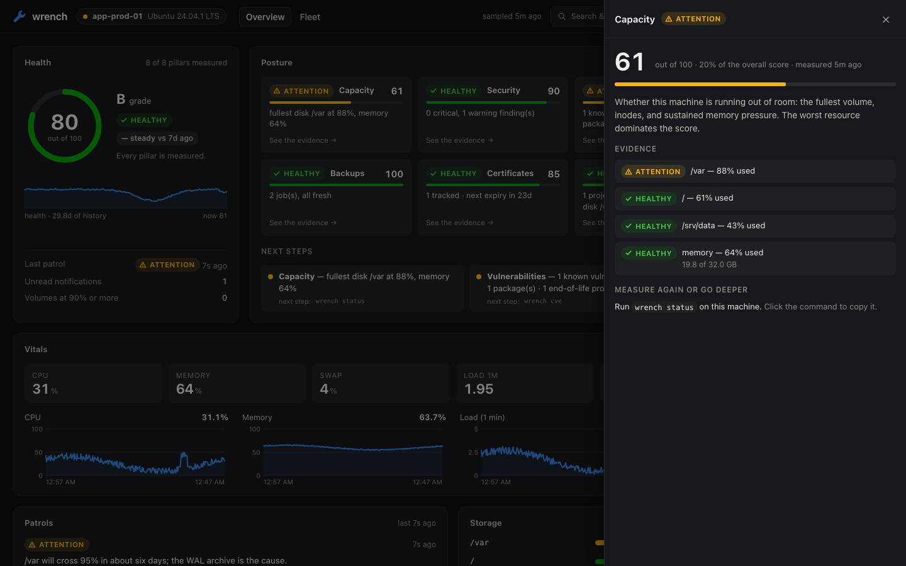
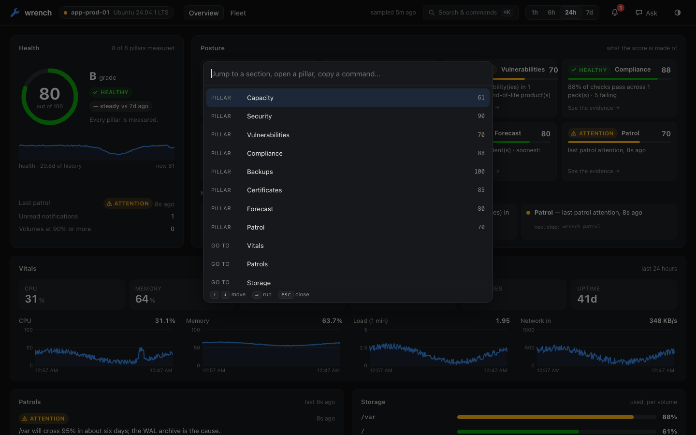
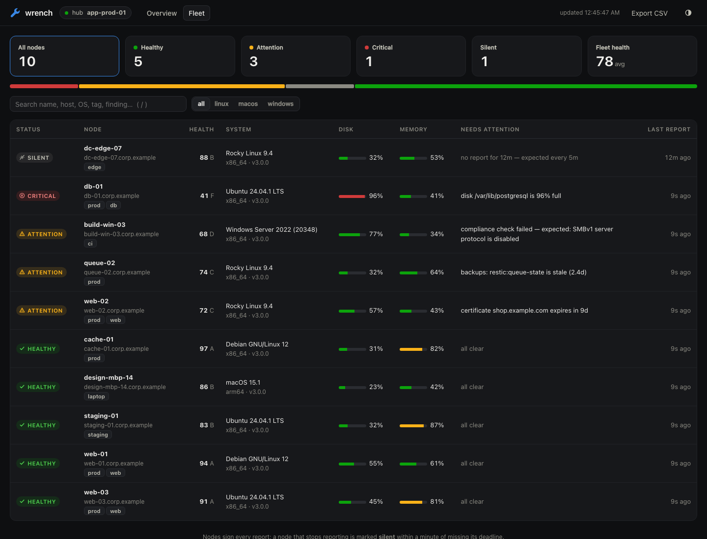
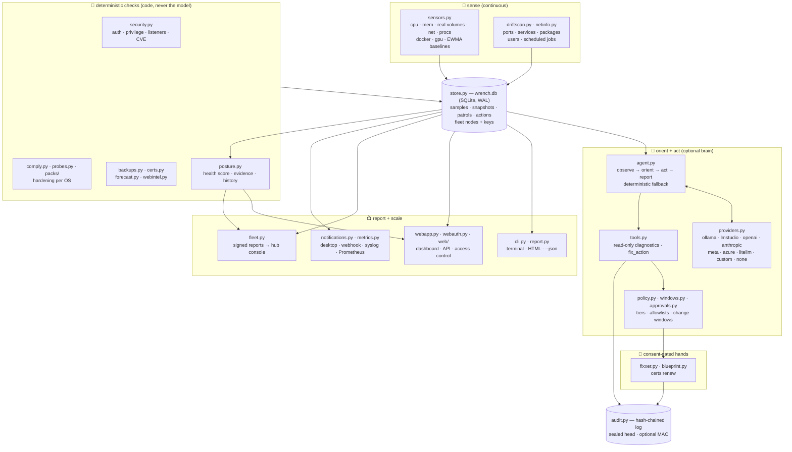

# 🔧 wrench

> **"I'm the sysadmin's right hand, and I live on your machine. I read the logs so you don't have to. I remember what changed. I explain problems in plain English — and with your permission, I fix them before you ever see them."**
>
> wrench is an **intentional agent for the people who run machines**: **senses** (live sensors + a SQLite time-series) + **memory** (learned baselines, drift snapshots, a hash-chained audit trail) + a **bring-your-own-mind brain** + **consent-gated hands**. It **sees** the box, **predicts** what's coming, **proves** what happened, **fixes** what it can — with your permission — and **scales** to a fleet.
>
> 🧠 **Bring your own mind.** Run wrench on a **fully local brain** ([Ollama](https://ollama.com) or LM Studio — private, free, nothing leaves the box) or on **any API brain** (OpenAI, Anthropic, Meta, Azure, LiteLLM, or any OpenAI-compatible endpoint via the `custom` provider). One agent loop, many doors, no favorites.

[](LICENSE)
[](pyproject.toml)
[](PLATFORMS.md)
[](#the-brain-is-swappable)
[](#policy-tiers--the-leash)
[](https://sunkencity999.github.io/wrench/)
[](https://github.com/sunkencity999/wrench/actions/workflows/ci.yml)

<p align="center">
  <a href="https://sunkencity999.github.io/wrench/"></a>
</p>

<p align="center">
  <a href="#60-second-quickstart"><b>Quickstart</b></a> ·
  <a href="docs/deployment.md"><b>Deployment guide</b></a> ·
  <a href="docs/configuration.md"><b>Configuration</b></a> ·
  <a href="SECURITY.md"><b>Security model</b></a> ·
  <a href="PLATFORMS.md"><b>Platforms</b></a> ·
  <a href="CHANGELOG.md"><b>Changelog</b></a> ·
  <a href="https://sunkencity999.github.io/wrench/"><b>Website</b></a>
</p>

## Contents

- **Start here** — [The problem](#the-problem-nobody-is-watching) · [Capability map](#the-capability-map--see--predict--prove--fix--scale) · [Quickstart](#60-second-quickstart) · [Your first five minutes](#your-first-five-minutes)
- **See** — [status](#wrench-status) · [score](#wrench-score--one-number-with-its-reasons) · [ask](#wrench-ask-) · [patrol](#wrench-patrol) · [drift](#wrench-drift) · [explain](#wrench-explain-service--port--pid--path) · [security](#wrench-security--watch-the-doors) · [dashboard](#wrench-report--wrench-web) · [notifications](#notifications--wrench-taps-you-on-the-shoulder)
- **Predict** — [cve](#wrench-cve--what-the-internet-already-knows-about-your-box) · [forecast](#wrench-forecast--see-the-incident-coming) · [certs](#wrench-certs--ssltls-lifecycle-from-inventory-to-renewal)
- **Prove** — [backups](#wrench-backups--untested-backups-dont-exist) · [audit](#wrench-audit--prove-what-happened) · [comply](#wrench-comply--prove-the-box-meets-the-baseline) · [bundle](#wrench-bundle--the-air-gap-evidence-bundle)
- **Fix** — [policy tiers](#policy-tiers--the-leash) · [fixxer](#wrench-fixxer--with-your-permission-i-fix-it) · [blueprint](#wrench-blueprint--declarative-config-automation)
- **Learn** — [memory](#wrench-remember--wrench-memory--it-learns-how-you-run-this-machine) · [jobs & heartbeat](#wrench-jobs--wrench-heartbeat--work-it-does-without-being-asked)
- **Models** — [connect a frontier model](#wrench-model--connect-a-frontier-model)
- **Scale** — [tutorial: many machines, one dashboard](#tutorial-many-machines-one-dashboard) · [fleet](#wrench-fleet--many-nodes-one-view) · [JSON, metrics, SIEM](#wire-it-into-your-stack----json-metrics-syslogsiem) · [offline mode](#offline--air-gap-mode--a-first-class-zero-egress-guarantee)
- **Understand it** — [How a patrol works](#how-a-patrol-works) · [The brain is swappable](#the-brain-is-swappable) · [Policy tiers](#policy-tiers--the-leash) · [Architecture](#architecture) · [Philosophy](#philosophy) · [FAQ](#faq)

| guide | read it when |
|---|---|
| [Deployment](docs/deployment.md) | putting wrench on a server, building a fleet with MDM or Ansible, exposing the hub, going air-gapped, upgrading, troubleshooting |
| [Configuration](docs/configuration.md) | you want to know what a setting does — every key, default and environment variable |
| [Security model](SECURITY.md) | deciding whether to trust it: what each surface defends against, and what it does not |
| [JSON & metrics](docs/json-output.md) | wiring it into CI, Prometheus, or a SIEM |
| [Platforms](PLATFORMS.md) | what is tested on Linux, macOS and Windows — and what is not |

## The problem nobody is watching

Your machine degrades slowly, and silently. A disk creeps from 60% to 94%
over three months. A service dies at 3 a.m. and nothing notices. A package
upgrade quietly changes a config. A port opens that you don't remember
opening. None of it pages you — until the day something actually breaks, and
then you're doing archaeology: scrolling logs, diffing configs from memory,
trying to reconstruct *what changed and when* from scraps.

The standard tools each solve a slice of this and leave the rest to you:

- `top`, `df`, `ps` show you **right now**, with no memory of last Tuesday.
- Logs remember everything and prioritize nothing.
- Monitoring stacks (Prometheus/Grafana) can watch trends — after you define
  the metrics, build the dashboards, tune the alerts, and run the stack. Great
  for fleets. Overkill for the one box you actually love.
- And none of them can *investigate*. A graph can scream; it can't find out why.

**wrench** closes the loop. It's a single `pip install` that gives you a tireless
right hand on the box itself. It does four things, continuously:

| | | |
|---|---|---|
| 📡 | **Sense** | Samples CPU, memory, swap, disks, network, processes, Docker, and GPU into a local SQLite time-series. Learns what "normal" looks like per metric (EWMA baselines) and flags statistical anomalies (z-scores) — not arbitrary thresholds. |
| 🧠 | **Remember** | Snapshots what the machine *is* — listening ports, running services, installed packages, user accounts, scheduled jobs — and diffs every scan into plain-English change history: "port opened: tcp/8081 (python3)", "package upgraded: openssl 3.0.13". When something breaks, the timeline already exists. |
| 💬 | **Explain** | An LLM agent with read-only diagnostic tools answers questions about *your* machine, grounded in its actual telemetry and logs — not generic trivia. "Why is my disk filling up?" gets investigated, not guessed at. |
| 🚓 | **Patrol** | On a schedule, wrench reviews the sensors, the anomalies, and the drift; investigates anything suspicious with real diagnostics; and files a report a human wants to read. Ok / attention / critical, findings with evidence, exact commands to fix. |
| 🔧 | **Fix** | `wrench fixxer` finds what's programmatically correctable — pending updates (incl. security), orphaned packages & old kernels, fat journald logs, bloated caches, stale `/tmp`, failed services — and applies the fixes you pick, with per-fix verification. Every fix is a hand-written catalog command; the model explains and helps you choose, but **never writes the shell**. Opt-in auto mode for self-healing boxes, behind a consent ceremony and an audit log. |
| 🔔 | **Notify** | When a patrol finds something worth your attention, wrench taps you on the shoulder: a desktop notification, an optional webhook (ntfy / Slack / Discord), a toast on the live dashboard, and a `🔔` banner on your next CLI command. Severity-thresholded, best-effort, never breaks a patrol. |
| 🛰️ | **Watch the horizon** | `wrench cve` checks installed packages against **[OSV.dev](https://osv.dev)** and the OS/kernel/runtimes against **[endoflife.date](https://endoflife.date)** — free public APIs, no keys. Known CVEs flow into patrols, the dashboard, and `fixxer` (which can apply *targeted* security updates for exactly the affected packages). Results cache locally with a TTL; patrols never fail because the internet is down. |

All of it runs locally, and **the brain is yours to choose**: point wrench at
[Ollama](https://ollama.com) or LM Studio and the whole agent — telemetry,
reasoning, everything — stays in the house, free; or plug in any API provider
(OpenAI, Anthropic, Meta, Azure, LiteLLM) when you want a bigger mind on the
case. Your telemetry never leaves the box unless *you* point the brain at a
cloud model.

### `wrench status` — the one-glance answer to "are we okay?"


### `wrench ask` — diagnosis grounded in real telemetry


*The dashboard and fleet screenshots further down show a fictional machine and
fleet, generated by [`scripts/demo_seed.py`](scripts/demo_seed.py) — run it to
explore the UI without pointing wrench at anything real.*

*Both GIFs are real, lightly-sanitized recordings from the dev box. In the
second one, wrench runs eight read-only diagnostics on its own, figures out
that 37 GiB of "used" swap is cold history rather than live memory pressure,
and closes with: "With 109 Gi swap, 33% is coffee, not fire."*

## The capability map — SEE · PREDICT · PROVE · FIX · SCALE

wrench is an intentional agent that works for the sysadmin: **senses** (live sensors + a SQLite
time-series), **memory** (learned baselines, drift snapshots, a hash-chained
audit trail), a **bring-your-own-mind brain** (any OpenAI-compatible endpoint —
local or API), and **consent-gated hands** (fixxer, blueprints, cert renewal).
Everything it can do falls into five arcs. Every row below is a real command on
main today — click through to its section.

**👁 SEE — watch the box, right now** *(read-only; never touches the machine)*

| command | what it does |
|---|---|
| [`wrench status`](#wrench-status) | one-screen health: gauges, sparklines, mounts, GPU, Docker, anomalies vs learned baselines |
| [`wrench score`](#wrench-score--one-number-with-its-reasons) | a deterministic 0–100 health score and grade across eight pillars, with the next step for each |
| [`wrench ask "…"`](#wrench-ask-) | LLM diagnosis grounded in *your* telemetry, running real read-only diagnostics |
| [`wrench patrol`](#wrench-patrol) | the full observe→orient→act→report loop; files a report a human wants to read |
| [`wrench drift`](#wrench-drift) | plain-English change history: ports, services, packages, users, cron |
| [`wrench explain`](#wrench-explain-service--port--pid--path) | investigate a service / `:port` / PID / path with grounded diagnostics |
| [`wrench security`](#wrench-security--watch-the-doors) | auth-log anomalies, new sudoers/authorized_keys, listener ownership |

**🔭 PREDICT — see it coming**

| command | what it does |
|---|---|
| [`wrench forecast`](#wrench-forecast--see-the-incident-coming) | trends disk / inode / memory / log growth into a "future incidents" feed |
| [`wrench certs`](#wrench-certs--ssltls-lifecycle-from-inventory-to-renewal) | TLS inventory + expiry ladder (30d→14d→7d) and weak-config audit |
| [`wrench cve`](#wrench-cve--what-the-internet-already-knows-about-your-box) | OSV.dev CVE matches + endoflife.date EOL checks (free APIs, cached) |

**🧾 PROVE — evidence, not vibes**

| command | what it does |
|---|---|
| [`wrench audit`](#wrench-audit--prove-what-happened) | append-only hash-chained log of every ceremony/consent/apply; `audit verify` |
| [`wrench backups`](#wrench-backups--untested-backups-dont-exist) | detect borg/restic/rsync/pg_dump jobs, confirm they actually ran |
| [`wrench drift`](#wrench-drift) baselines | labeled drift snapshots are the before/after proof for every change |
| [`wrench comply`](#wrench-comply--prove-the-box-meets-the-baseline) | deterministic hardening packs for Linux, macOS and Windows, scored, offline |
| [`wrench bundle`](#wrench-bundle--the-air-gap-evidence-bundle) | one portable tar.gz of the whole box state (patrol/status/drift/security/comply/audit…) for sneakernet review — no secrets |

**🔧 FIX — with your permission** *(consent-gated, policy-tiered, auto-rollback)*

| command | what it does |
|---|---|
| [`wrench fixxer`](#wrench-fixxer--with-your-permission-i-fix-it) | applies hand-written catalog fixes you pick, per-fix verified; opt-in auto mode |
| [`wrench blueprint`](#wrench-blueprint--declarative-config-automation) | LLM-drafted config change → diff → consent → apply → validate → rollback |
| [`wrench certs renew`](#wrench-certs--ssltls-lifecycle-from-inventory-to-renewal) | certbot/acme.sh renewal under the ceremony: dry-run → validate chain → reload |

**🛰 SCALE — many machines, wired into your stack**

| command | what it does |
|---|---|
| [`wrench fleet`](#wrench-fleet--many-nodes-one-view) | many machines → one console; one-command enrollment, signed reports, silent-node detection |
| [`--json` / `/metrics` / SIEM](#wire-it-into-your-stack----json-metrics-syslogsiem) | machine-readable JSON everywhere, a Prometheus exporter, syslog/SIEM sinks |
| [webhook approvals · maintenance windows](#wire-it-into-your-stack----json-metrics-syslogsiem) | async out-of-band approval tokens; change-windows that gate executing fixes |
| [`offline = true`](#offline--air-gap-mode--a-first-class-zero-egress-guarantee) | **declared zero-egress mode** for classified / OT / shipboard boxes: refuse every public call, keep the local brain + LAN fleet |

## 60-second quickstart

**Linux**

```bash
curl -fsSL https://raw.githubusercontent.com/sunkencity999/wrench/main/scripts/install.sh | bash
# or: pipx install git+https://github.com/sunkencity999/wrench
```

**macOS**

```bash
# needs python 3.10+ (brew install python if you don't have it)
curl -fsSL https://raw.githubusercontent.com/sunkencity999/wrench/main/scripts/install.sh | bash
```

**Windows (PowerShell)**

```powershell
irm https://raw.githubusercontent.com/sunkencity999/wrench/main/scripts/install.ps1 | iex
```

Then, on any OS:

```bash
wrench init                 # pick a brain (local or API), set a dashboard password, record baselines
# bringing an API mind? export its key — OPENAI_API_KEY / ANTHROPIC_API_KEY /
# META_API_KEY / AZURE_OPENAI_API_KEY — or none at all for Ollama / LM Studio
wrench doctor               # verify sensors, platform capabilities, provider liveness
wrench status               # one-screen health
wrench patrol               # send it on its rounds
wrench score                # one health number, with the reasons behind it
wrench web                  # dashboard at http://127.0.0.1:8787
wrench install-service      # start the heartbeat: patrols + scheduled jobs (systemd / launchd / Task Scheduler)
wrench remember "…"         # tell it how you run this machine; it keeps that in mind from now on
```

### Your first five minutes

Run `wrench` with no arguments at any time. It shows where the machine stands
and the single next command worth running:

```text
╭─ 🔧 wrench ───────────────────────────────────────────────────────────────╮
│ app-prod-01  ·  Ubuntu 24.04.1 LTS  ·  wrench 3.0.0                        │
│ health 80/100  grade B  ·  8 of 8 pillars measured                         │
│ last patrol attention, 7m ago: /var will cross 95% in about six days       │
╰────────────────────────────────────────────────────────────────────────────╯
next  wrench security accept   After this, only NEW listeners, keys and sudoers changes raise an alarm.

see      status · score · patrol · ask "…" · drift · security
predict  forecast · certs · cve
prove    audit verify · backups · comply · bundle
fix      fixxer · blueprint "…"
learn    remember "…" · memory · jobs · heartbeat
scale    web · password · fleet connect / serve · metrics
setup    init · doctor · install-service
```

The same five steps appear as a checklist at the top of the dashboard on a new
install — run a patrol, schedule patrols, accept a security baseline, have a
verified backup, optionally connect a model — and tick themselves off.
`wrench --help` lists every command grouped by the same five arcs.

**No model? wrench still does its job.** Every check that pages is code, so
with no brain configured a patrol runs in *deterministic mode*: sensors, drift,
certificates, security, backups, compliance and forecast all run, the report is
filed, the fleet hub is told. You can skip `init` entirely on a server and
start with `wrench patrol`. A brain adds investigation, narrative and chat —
and if you run [Ollama](https://ollama.com) it never leaves the box:
`wrench patrol -p ollama -m llama3.1`.

> **Platform honesty:** Linux and macOS are exercised end-to-end on real
> hardware. Windows is implemented behind the same platform abstraction with
> unit-tested branches and runs in CI, but has not had a native hands-on pass —
> details in [PLATFORMS.md](PLATFORMS.md). If you run wrench on Windows, please
> open an issue with your `wrench doctor` output.

## The CLI, command by command

Every command below is real output from the dev box (hostnames and paths
sanitized). Click to expand. The commands are grouped into the five arcs of the
work — **SEE → PREDICT → PROVE → FIX → SCALE** — the same shape as the
capability map above.


## SEE — watch the box, right now

Look at what's happening and what changed. These are read-only: they never touch the machine.

### `wrench status`

One screen: gauges with 24h sparklines, every mount, load, network rates, GPU,
Docker, and any anomalies against learned baselines.

<details>
<summary>example output</summary>

```text
╭────────────────────────── 🔧 wrench status ──────────────────────────╮
│                                                                      │
│             CPU  █░░░░░░░░░░░░░░░░░   5.8%   █▅▆▄▅▁▂▂▆▂▁▂▄▁▁▁▁▁▁▁▁▂  │
│             MEM  ████░░░░░░░░░░░░░░  24.5%   ▂▄▂▁▇▇▇▇█▁▁▂▂▁▁▁▁▁▁▁▁▁  │
│            SWAP  █████░░░░░░░░░░░░░  33.2%                           │
│          disk /  ███████░░░░░░░░░░░  43.7%                           │
│  disk /mnt/tank  █████████░░░░░░░░░  52.8%                           │
│  disk /mnt/nvme  █████████░░░░░░░░░  51.7%                           │
│                                                                      │
│  load 0.63 / 0.77 / 1.26   procs 683   up 223h   net ↓179 ↑72 KB/s   │
│  gpu NVIDIA RTX PRO 6000: 0% util, 96375/97887 MB, 33°C              │
│  docker: 5/8 containers running                                      │
│  no anomalies in 24h — baselines quiet                               │
│                                                                      │
╰────────────────────────── 2026-11-04 01:23:02 ───────────────────────╯
```
</details>


### `wrench score` — one number, with its reasons

"How is this box, really?" should not require reading eight reports.

```console
$ wrench score
╭────────── 🔧 wrench score ──────────╮
│ 87 / 100   grade B                  │
│ 7 of 8 pillars measured             │
╰─────────────────────────────────────╯
 pillar           score               why
 Capacity           100  ██████████   fullest disk / at 25%, memory 62%
 Security            90  █████████░   no critical or warning findings · no accepted baseline
 Vulnerabilities     85  ████████░░   no known CVEs in 27 packages · 1 end-of-life product(s)
 Compliance          79  ████████░░   79% of checks pass across 1 pack(s) · 3 failing
 Backups             75  ████████░░   1 job(s): 0 failing integrity, 1 stale or unverified
 Certificates         —  not measured no certificates tracked — run `wrench certs`
 Forecast           100  ██████████   no incidents projected in the next 30 days
 Patrol              70  ███████░░░   last patrol attention, 11m ago
```

The score is arithmetic over what each subsystem last measured — the model is
never asked how healthy the box is. Four rules keep it honest:

- A pillar with no data is **unmeasured**, shown as such and left out of the
  average. The header says how many were measured.
- Until at least half of the score's weight has been measured, the number is
  **provisional**: no grade, no "healthy". A new install with one clean pillar
  is unmeasured, not an A.
- One **critical** pillar caps the total, so it cannot hide in a good average.
- Every pillar carries its reason and the command that improves it.

| pillar | weight | what it measures |
|---|---|---|
| Capacity | 20 | fullest volume, inodes, sustained memory pressure |
| Security | 20 | sign-in anomalies, privilege drift, listeners vs. the accepted baseline |
| Vulnerabilities | 15 | known CVEs in installed packages; end-of-life OS and runtimes |
| Compliance | 15 | the hardening pack for this OS |
| Backups | 12 | jobs exist, ran on schedule, and answer |
| Certificates | 8 | soonest TLS expiry |
| Forecast | 5 | projected capacity incidents |
| Patrol | 5 | patrols are running, and what the last one found |

wrench records the score at every patrol, so the dashboard shows the trend and
how it compares with a week ago. The same number appears in `wrench status`, the
dashboard, every fleet report, `--json` (`wrench.score.v1`, exit 1 attention /
2 critical) and Prometheus (`wrench_health_score`, `wrench_health_pillar_score`).


### `wrench ask "…"`

One question, investigated. The agent gets a read-only toolbelt (logs, process
tables, sockets, disk trees, allowlisted diagnostics) and must cite evidence.

<details>
<summary>example: "which disk will fill up first, and what's the biggest hog on it?"</summary>

```text
$ wrench ask "which disk will fill up first, and what's the biggest hog on it?"
  ⚙ run_diag {"command": "df -h"}
  ⚙ disk_tree {"path": "/mnt/tank", "depth": 1}
  ⚙ disk_tree {"path": "/home/user/storage", "depth": 1}
  ⚙ disk_tree {"path": "/", "depth": 1}
╭──────────────────────────────── 🔧 wrench ────────────────────────────────╮
│  1. Most likely to fill first: /home/user/storage (/dev/sdb)              │
│   • df -h: 1.8T size, 1019G used, 722G avail, 59% use                     │
│   • highest use% and the smallest headroom — at equal write rates         │
│     it hits 100% first.                                                   │
│                                                                           │
│  2. Biggest hog on it? du only accounts for ~42G of 1019G. du stderr      │
│     names the suspect: 'backups/borg-system': Permission denied.          │
│     The real hog is almost certainly in root-owned backups, or            │
│     deleted-but-open files.                                               │
│                                                                           │
│  To confirm (suggest tier — run as human):                                │
│   sudo du -xhd1 /home/user/storage 2>&1 | sort -hr                        │
│   sudo lsof +L1 | grep -E 'storage|deleted'                               │
╰───────────────────────────────────────────────────────────────────────────╯
```

Note what happened there: it didn't guess, it measured; it noticed the du/df
discrepancy; and because it's in the default **suggest** tier, it handed the
privileged commands to the human instead of running them.
</details>


### `wrench patrol`

The heart of wrench — see [the next section](#how-a-patrol-works).


### `wrench drift`

"What changed on this box?" — the question behind 90% of debugging sessions.

<details>
<summary>example output</summary>

```text
$ wrench drift
╭────────────────────────── 🔧 wrench drift ──────────────────────────╮
│ ports                                                               │
│   • port opened: tcp/8790 (python3)                                 │
│ packages                                                            │
│   • package upgraded: openssl 3.0.13-0ubuntu3.6                     │
│   • package installed: mailutils                                    │
│ services                                                            │
│   • service stopped: user:comfy-local.service                       │
╰─────────────────────────────────────────────────────────────────────╯
```

First run records the baseline; every run after that is a diff. `--narrate`
adds a model's risk assessment of the changes. Snapshots cover listening
ports, running services, installed packages, user accounts, and scheduled
jobs (cron / LaunchAgents / Scheduled Tasks, per OS).
</details>


### `wrench explain <service | :port | PID | /path>`

Point at a thing, get a briefing: what it is, whether it's healthy, whether it
should be there.

<details>
<summary>example: <code>wrench explain :8787</code></summary>

```text
$ wrench explain :8787
  ⚙ net_listeners {}
  ⚙ run_diag {"command": "ps aux"}
╭──────────────────────────────── 🔧 wrench ────────────────────────────────╮
│  tcp/8787 is a python3 process — wrench's own web dashboard               │
│  (wrench/webapp.py), bound to 127.0.0.1 only. Loopback-bound, so          │
│  it is not exposed to the network. Healthy and expected.                  │
╰───────────────────────────────────────────────────────────────────────────╯
```
</details>


### `wrench security` — watch the doors

The box is only as safe as the ways into it. `wrench security` keeps four
read-only watchers on those doors and runs them through one severity ladder.

```console
$ wrench security
📡 listening sockets        ← socket · addr · process · systemd unit
🛡️ security findings        ← sev · area · finding · detail
```

**auth.** I parse `auth.log` / `secure` (or journald when there's no file) for
SSH and sudo events, then flag what matters: a **brute-force burst** (many
failed passwords from one IP inside a sliding window), a **successful login
right after a burst** from that same IP (treated as critical — assume
compromise until proven otherwise), logins from **source IPs never seen before**
your baseline, and users **newly invoking sudo**.

**access.** Privilege drift is the quiet kind. I hash `/etc/sudoers` and every
`/etc/sudoers.d` drop-in, hash each account's `authorized_keys`, and watch for
**extra UID-0 accounts**, **empty password hashes** (when `/etc/shadow` is
readable — I degrade politely when it isn't), and **world-writable files** in
sensitive paths. New or changed entries alarm against the accepted baseline.

**listeners.** I inventory every listening socket with its owning process and
systemd unit (`ss`, with a psutil fallback). A **new listener** since the
baseline is a warning; an **ownerless** one — a socket no process admits to,
seen with full root visibility — is worth a hard look. Running without root? I
say so once instead of crying wolf on every socket I simply can't attribute.

**cve.** I take your **full installed-package inventory** (dpkg/rpm) and match
it against the **OSV.dev** batch API — free, keyless, cached in SQLite with a
TTL, and strictly **fail-soft**: no network, no scan, no drama. New serious
(critical/high) CVEs since the last scan are called out as `[NEW]`.

Everything here is **read-only** — nothing I touch mutates host state. A
baseline is blessed **only by explicit consent** (`wrench security accept`);
scans compare against it and never silently update it. Findings feed patrols,
`--json` (`wrench.security.v1`, exit 1 on a critical), the Prometheus exporter
(`wrench_security_findings`, `…_listeners`, `…_cves_known`, `…_baseline_accepted`),
and an optional brain briefing that triages the lot in plain English — analysis
only, it never executes anything. Bring your own mind; the doors are watched
either way.


### `wrench chat`

The same agent, conversational — for incidents with plot twists. It keeps
context across turns, so "what about the other disk?" works.

It can also set things up with you. "Set this machine up as the hub" or
"connect this machine to the hub at 192.168.1.10" starts a
[guided, step-by-step setup](#the-guided-way-let-wrench-walk-you-through-it):
it explains each step, does it when you say yes, and has you type passwords
privately rather than into the conversation.


### `wrench watch`

Foreground patrol loop (`--interval` seconds) for when you want a live
terminal sentinel instead of a scheduled service.


### `wrench report` / `wrench web`

`report` lists recent patrols with status and token cost. `web` serves the
dashboard: the health score and its eight pillars with next steps, vitals with
hover charts over 1 hour to 7 days, storage, top processes, the patrol feed
with findings, what changed, vulnerabilities and end-of-life, the action log
and the audit chain's integrity — all rendered from the same SQLite file, zero
build step, zero CDN. Light and dark follow your OS.


**Built to be used, not just looked at.**

- **Every number opens.** Click a posture pillar and a panel shows what it
  measures, its share of the score, and the evidence — each volume, finding,
  failing rule, backup job or certificate — with the command to run next.
  Each panel has its own link (`/#pillar=backups`) to paste into a ticket.
- **⌘K / Ctrl-K** opens a command palette: jump to a section, open a pillar,
  switch the time range or theme, or copy any `wrench` command.
- **Click any command to copy it.** Wherever the page names a command, it is
  a button.
- **A health trend.** The score's history, and how it compares with a week ago.
- **A first-run guide** that walks a new machine through five one-command
  steps and disappears when they are done.
- **Phone-sized screens work**, and motion is reduced when your OS asks for it.

| | |
|---|---|
|  |  |

**And I'm in there.** *Ask* opens a conversation with me — the same agent loop
as `wrench chat`, diagnostics and all, so "what's eating RAM?" gets
*investigated* from your browser.

Keyboard shortcuts: <kbd>⌘K</kbd> or <kbd>/</kbd> command palette ·
<kbd>c</kbd> ask · <kbd>n</kbd> notifications · <kbd>r</kbd> refresh ·
<kbd>t</kbd> theme · <kbd>f</kbd> fleet · <kbd>?</kbd> help · <kbd>Esc</kbd> close.

**Who can see it.** Put a password on it. `wrench init` offers to, and
`wrench password` sets, changes or removes one at any time:

```bash
wrench password             # set or change it (asks twice, never echoes)
wrench password --status    # is one set?
wrench password --clear     # remove it
echo "$PW" | wrench password --stdin    # from a secret store, for scripted installs
```

With a password set, every visit to the dashboard or the fleet console signs
in — on this machine too. A change reaches a running server straight away and
signs out every browser. Only a salted scrypt hash is stored, owner-only, in
the data dir. Forgot it? Run `wrench password` again.

Without a password, on `127.0.0.1` (the default) there is no sign-in, and the
server answers only to loopback host names, so a web page cannot reach it
through DNS rebinding. Bind it anywhere else and every page and API call needs
a credential — you cannot accidentally publish a machine's telemetry:

```bash
wrench web --bind 0.0.0.0 --tls-cert fullchain.pem --tls-key privkey.pem
# without a password or a token of your own, prints an access token
# (generated once, stored owner-only)
```

```toml
[web]
auth_token   = "…"   # full access   (or env WRENCH_WEB_TOKEN)
viewer_token = "…"   # read-only: the wall display — no chat, no changes
```

Browsers sign in once, with the password or a token, and get a signed,
HttpOnly, SameSite=Strict session; scripts and Prometheus send
`Authorization: Bearer <token>` (the password is for people, not for headers). `/healthz` is the
only unauthenticated route and carries no data. Details: [SECURITY.md](SECURITY.md).


### Notifications — "wrench taps you on the shoulder"

A patrol that finds trouble shouldn't wait for you to ask. When a patrol's
findings meet the severity threshold, wrench writes a notification to a local
JSONL inbox (`~/.local/share/wrench/notifications.jsonl`) and fans it out:

- **Desktop** — `notify-send` (Linux), `osascript` (macOS), or a PowerShell
  toast (Windows). Best-effort: silently skipped if unavailable.
- **Webhook** — one generic JSON POST that ntfy, Slack, and Discord-style
  receivers all understand. Short timeout; failures are logged, never fatal.
- **Dashboard** — unread notifications appear as toasts (top-right) on
  `wrench web`; clicking one opens that patrol's report and marks it read.
- **CLI** — `status`, `report`, `chat`, and `ask` print a one-line 🔔 banner
  when unread findings exist; viewing `wrench report` marks them read.
  `wrench watch` prints notifications inline as they occur.

Configure it in `config.toml`:

```toml
[notify]
enabled = true               # master switch
min_severity = "attention"   # attention | error | critical
desktop = true
# webhook_url = "https://ntfy.sh/your-topic"
# syslog_address = "/dev/log"            # or udp://siem:514 / tcp://siem:601
# syslog_min_severity = "attention"      # per-sink threshold override
# http_jsonl_url = "https://splunk:8088/services/collector/raw"   # ndjson POST
# http_jsonl_min_severity = "error"
```

Severity is the worst of the patrol's status and its individual findings, so
an "attention" patrol carrying one `[critical]` finding notifies as critical.


## PREDICT — see it coming

Turn trends and the outside world into a heads-up before the incident.

### `wrench cve` — what the internet already knows about your box

```console
$ wrench cve
🚨 known vulnerabilities (OSV.dev)      ← package · installed · CVE ids · severity · fixed-in
⏳ end-of-life status (endoflife.date)  ← os · kernel · python · node
```

I inventory what's actually installed — pip packages, npm globals, and a
curated watchlist of security-critical distro packages (openssl, openssh,
sudo, systemd, …) — and ask OSV.dev what's known about *those exact
versions*. Then endoflife.date tells me whether the OS, kernel, python, and
node you're running still get security support at all. I summarize what
matters in plain English, and if fixed builds exist, `wrench fixxer` stages a
targeted `--only-upgrade` for just the affected packages (moderate tier — you
consent, as always). EOL products get flagged, never auto-"fixed": a major OS
upgrade is your decision, not mine.

Everything caches in the same SQLite store (24h TTL, `[webintel]` knobs in
config: `enable`, `cadence_hours`). Offline? I serve the cached scan and say
so. Exit code 1 when vulns are found, so you can wire it into CI or cron.


### `wrench forecast` — see the incident coming

Monitoring tells you the disk *is* full. Forecasting tells you it *will be* —
while there's still time to be graceful about it.

```console
$ wrench forecast
🔮 future incidents          ← what · now · growth/day · crosses · ETA · confidence
   disk /var                  78.4%   +1.9%/day        95%     in ~9d    high
   cert jellyfin.local        —       —                expiry  in 11d    certain
```

A **least-squares trend engine** runs over the sensor history the box already
records (the same samples `wrench status` stores): disk per mount, **inodes**,
memory, swap, and `/var/log` growth. It refuses to guess — projections need a
minimum sample count *and* time span, confidence comes from R² and history
depth, and a shrinking series never cries wolf. Certificate expiry joins the
same **unified future-incidents feed**, so "disk full Tuesday" and "cert dead
Friday" page through one lead-time ladder (≤14d info, ≤7d warning, ≤3d
critical). Feeds patrols, `--json` (`wrench.forecast.v1`), and Prometheus
(`wrench_forecast_days_to_threshold`, `…_incidents`). The trend math is code —
the model is never asked when your disk fills.


### `wrench certs` — SSL/TLS lifecycle, from inventory to renewal

Certificates are the quiet way production breaks: a leaf expires on a Sunday
and the whole site goes dark. `wrench certs` keeps the whole lifecycle in view.

```console
$ wrench certs
🔐 certificate inventory
 name            expires in   issuer        key        flags         source
 shop.example.com      12d   R3            RSA-2048    ok            nginx:/etc/nginx/sites/shop
 api.example.com       64d   R3            RSA-2048    ok            nginx:/etc/nginx/sites/api
 legacy.internal   EXPIRED    legacy.int    RSA-1024    self-signed weak-key   wellknown:/etc/ssl
```

**Inventory.** I discover certs two ways: by scanning your web-server configs
(`nginx` / `apache` / `caddy` / `haproxy` — `ssl_certificate`,
`SSLCertificateFile`, `tls`, `bind ... ssl crt`) and by walking the well-known
stores (`/etc/letsencrypt/live`, `/etc/ssl`, `/etc/pki`). Each one is parsed
with `openssl` — expiry, subject, SANs, issuer, key type/strength, self-signed
detection, and a chain-completeness check — and persisted in the same SQLite
store everything else uses. `--probe` adds a read-only TLS handshake against
local listeners to see what's *actually* negotiated.

**Patrol integration.** Every patrol folds in a deterministic expiry ladder —
**≤30d info · ≤14d warning · ≤7d or expired critical** — plus weak-config flags
(TLS below 1.2, weak keys `<2048`-bit RSA, incomplete chains). Those ride the
existing notification channel (desktop / webhook / dashboard toast / CLI
banner). The model never computes an expiry date — that math is code.

**Audit.** `wrench certs audit` is the posture review: protocols, ciphers,
HSTS, and OCSP-stapling hints pulled from your configs plus a live probe of
local listeners, then narrated in plain English through whatever brain you've
configured (provider-agnostic — same `--no-llm` opt-out as everywhere else).

**Renewal — consent-gated, dry-run first.** `wrench certs renew <name|--all>`
orchestrates `certbot` or `acme.sh` under the same discipline as `fixxer`:

```text
🔁 renewal — shop.example.com
 ✓ dry_run         certbot renew --dry-run succeeded
 ✓ renew           new certificate issued
 ✓ validate_chain  chain verified against system trust store
 ✓ reload_test     nginx -t: syntax ok
 ✓ reload          systemctl reload nginx
 ✓ probe           TLSv1.3 cert 89d
 renewal complete, chain validated, nginx reloaded
```

It **dry-runs first** (and stays dry-run unless you pass `--execute`), only ever
invokes an allowlisted ACME client (no model-authored shell, no shell-meta
characters), validates the new chain with `openssl` **before** trusting it,
tests the service config (`nginx -t`) **before** reloading, and never reloads a
service against an unvalidated certificate. Any failed step stops the pipeline
with a rollback message — the old cert stays in place, the service keeps
running on its known-good config. Real renewals require policy tier
`repair`/`autonomous` or a one-time `wrench certs renew --setup-consent`
ceremony; every attempt is logged to the actions table.


## PROVE — evidence, not vibes

Make the machine's history and its safety nets verifiable.

### `wrench backups` — untested backups don't exist

Every sysadmin horror story ends the same way: *"…and then we checked the
backups."* `wrench backups` checks them **before** the story starts.

```console
$ wrench backups
🧰 backup jobs               ← job · origin · schedule · last run · freshness · integrity
   borg:borg-system-backup    borg-system-backup.timer   Sun 03:00   2.1d ago   fresh   ok
   pg_dump:app-nightly        /etc/cron.d/app            @daily      26h ago    fresh   ok
```

**Detection** — I find the backup jobs the box *actually* has: crontabs
(system, `/etc/cron.d`, user, the periodic dirs) and **systemd timers**, with
recognition for borg, restic, rsync, pg_dump/pg_dumpall, mysqldump,
rdiff-backup, and duplicity. Wrapper scripts are **followed and read** — a
`backup.sh` that exports `BORG_REPO` and calls `borg create "::$ARCHIVE"`
resolves to the real tool and the real repository.

**Verification ladder** — L1: *did it run recently?* (systemd exec timestamps,
destination mtimes, judged against each job's own parsed cadence — a weekly
job isn't "stale" on day three). L2: *is the repository sane?* (read-only:
`borg list`, `restic snapshots`, dump freshness + a zero-byte check; an
encrypted repo I can't open is reported **locked**, not failed). L3, optional
and consent-gated: `--restore-test` proves restorability with read-only
variants (borg `extract --dry-run`, `restic check`).

A box with **zero detected backup jobs gets a warning** — that's a finding,
not a shrug. Everything feeds patrols, `--json` (`wrench.backups.v1`, exit 1
on critical), Prometheus (`wrench_backup_freshness_seconds`,
`…_job_severity`), and an optional brain briefing that answers the only
question that matters: *could this box be restored today?*


### `wrench audit` — prove what happened

Compliance asks a brutal question: *can you prove nothing was tampered with?*
`wrench audit` answers it. Every consequential act — consent grants and denials,
fixxer applies, blueprint applies and rollbacks, certificate renewals, security
baseline accepts, policy-tier changes, maintenance-window overrides — is appended
to a **hash-chained, append-only JSONL log** in the data dir. Each record carries
the hash of the one before it:

```
{ts, actor, kind, detail, prev_hash, hash}
hash = sha256(prev_hash + canonical(ts, actor, kind, detail, prev_hash))
```

The first write seeds a `genesis` record (prev_hash = 64 zeros). The wiring uses
the **narrowest choke point** — `store.add_action`, which every mutation already
flows through — plus explicit seals for the consent/baseline/override events that
don't.

```console
$ wrench audit                 # recent events, rich table (+ --json wrench.audit.v1)
$ wrench audit verify          # re-walk the chain
✔ INTACT — 7 event(s), every link verified.
```

Flip a single byte anywhere in the log and `verify` names the **exact first broken
link** and exits non-zero:

```console
$ wrench audit verify
✗ TAMPER DETECTED
first broken link: record #3 of 7
reason: record altered: stored hash does not match its contents
# exit code 1
```

Because each hash folds in the previous one, altering record *n* invalidates *n*
and everything after it — you cannot quietly rewrite history and re-seal it
without the genesis-anchored chain exposing the edit.

**Maintenance windows.** Enterprises don't let tools mutate production whenever
they please. Set allowed windows and executing state-changes (fixxer apply,
`blueprint --execute`, `certs renew --execute`) are blocked outside them:

```toml
[maintenance]
windows  = ["Sat 02:00-06:00", "Sun 02:00-06:00", "Mon-Fri 23:00-23:59"]
timezone = "America/Los_Angeles"   # optional; local time if unset
```

Outside a window the op exits with a clear message. `--override-window` proceeds
anyway **but only with consent**, and the override is itself audit-logged. Empty
or missing config means **no windows = current behavior**, so a home user sees
zero change.

**Webhook approvals.** For an async, two-channel approval (Slack/Teams-style)
without standing up a server: wrench POSTs a pending approval
`{action, detail, token, expiry}` to `approval_webhook_url`, and a second channel
approves it:

```toml
[approvals]
approval_webhook_url = "https://hooks.example.com/wrench"
ttl_minutes          = 60
```

```console
$ wrench approve <token>       # from the approving channel; single-use, TTL-bound
$ wrench approvals             # list token states (hashes only, never plaintext)
```

Tokens are stored **hashed** in sqlite with a TTL and are single-use; a non-TTY
run with a pending-but-unapproved action exits cleanly with *"pending approval"*
instead of hanging. All three features — audit is always on; windows and
approvals **default OFF**.


### `wrench comply` — prove the box meets the baseline

"Are we hardened?" shouldn't be a feeling. `wrench comply` audits the box
against **declarative compliance packs** and answers with a score.

```console
$ wrench comply
📋 Ubuntu hardening essentials (inspired by CIS L1) — score 56.8%
   ✖ fail   high     sshd.passwordauth   sshd disables password authentication
   ✖ fail   medium   login.umask         Default UMASK is 027 or stricter
   ✔ pass   critical perm.sudoers        /etc/sudoers is 0440
   · skip   critical auth.noemptypw      (needs root to read /etc/shadow)
```

Four packs ship, and only the ones written for the OS you are on run by
default: **`cis-ubuntu-essentials`** (~40 high-value Ubuntu 22.04/24.04 checks
inspired by CIS Level 1 — honestly named, not certified CIS content),
**`wrench-baseline`** (15 opinionated Linux basics), **`macos-baseline`**
(FileVault, System Integrity Protection, Gatekeeper, firewall, automatic
security updates, screen lock, guest and auto-login) and **`windows-baseline`**
(Defender real-time protection, firewall profiles, BitLocker, UAC, SMBv1, RDP
network-level auth, LSA protection). The macOS and Windows checks have no file
to read, so they use a closed registry of hand-written, read-only **probes**
([`wrench/probes.py`](wrench/probes.py)) — a pack can name a probe, never
supply a command. Rules cover sshd hardening (with real first-wins + `Match`-aware
config parsing, drop-ins included), auth-file permissions and ownership,
empty-password and extra-UID-0 detection, live-kernel sysctl posture, mount
options, legacy-service absence, and `login.defs` policy.

The engine is the point: packs are **data, not code** — every rule names one
of eleven read-only check primitives that map to safe internal functions.
Nothing in a pack is ever executed as a shell string, checks are
**deterministic code** (the model is never asked whether you're compliant),
and everything runs **fully offline**. A file that needs root is a counted
`skip` — never a fake pass, never noise. Skips don't dilute the score.

`wrench comply accept` blesses the current failures as **known debt** through
the same consent ceremony as everything else (and seals the accept into the
audit chain); from then on patrols alarm only on **new** failures. `comply
show <rule>` explains any rule: what it checks, why it matters, and what the
box says right now. Feeds `--json` (`wrench.comply.v1`, exit 1 on a critical
fail), Prometheus (`wrench_comply_score`, `…_fails`, `…_baseline_accepted`),
and an optional brain briefing that separates what matters from checkbox
noise — analysis only.

### `wrench bundle` — the air-gap evidence bundle

The air-gap answer to *"email me the state of the box."* On a classified,
industrial, or shipboard host you cannot screen-share or SSH out — but you can
carry a USB stick.

```bash
wrench bundle                      # ./wrench-bundle-<host>-<date>.tar.gz
wrench bundle --out /mnt/usb/box.tar.gz
wrench bundle --json               # wrench.bundle.v1: path, bytes, files[]
```

One self-contained `tar.gz` with a human-readable **SUMMARY.md** plus one JSON
file each for: the latest **patrol**, a live **status** snapshot, **drift**
changes, **security** findings, **comply** results, the **backups** report, the
**forecast** feed, the tamper-evident **audit** chain (and its verify verdict),
a **notifications** tail, **versions**, the **offline** posture, and a
secret-redacted copy of your config. Filenames are deterministic and the writer
is reproducible (fixed member metadata + zeroed gzip mtime), so identical inputs
produce identical bytes.

**No secrets leave the box.** The config snapshot is walked and every key-ish
field (`api_key` / `token` / `secret` / `password` / `credential` / …) is
redacted; the live API key is never touched. Every collector is isolated — one
broken subsystem records an error stub and the bundle still builds. Unpack it
anywhere with `tar xzf` and read `SUMMARY.md` first.

## FIX — with your permission, I fix it

Every change here is consent-gated and policy-tiered: diff/preview → your yes → apply → verify → auto-rollback on failure. The model explains and helps you choose; it never writes the shell.

### `wrench fixxer` — "with your permission, I fix it"

Everything above looks and explains. `fixxer` is the hands. It scans the box
for issues that are *programmatically correctable* and presents a numbered,
risk-labeled menu:

```text
I'm going through the box looking for things I can fix myself...

                     🔧 correctable issues I found
 ┏━━━┳━━━━━━━━━━┳━━━━━━━━━━━━━━━━━━━━━━━━━━┳━━━━━━━━━━━━━━━━━━━━━━━━━━━━━━┳━━━━━━┓
 ┃ # ┃   risk   ┃ fix                      ┃ evidence                     ┃ sudo ┃
 ┡━━━╇━━━━━━━━━━╇━━━━━━━━━━━━━━━━━━━━━━━━━━╇━━━━━━━━━━━━━━━━━━━━━━━━━━━━━━╇━━━━━━┩
 │ 1 │   safe   │ Shrink journald logs     │ journald uses 4096 MB        │  ✓   │
 │ 2 │   safe   │ Clear package cache      │ apt cache holds 2015 MB      │  ✓   │
 │ 3 │ moderate │ Apply pending updates    │ 242 upgradable (3 security)  │  ✓   │
 │ 4 │ moderate │ Remove orphaned packages │ 3 removable, incl. 1 kernel  │  ✓   │
 └───┴──────────┴──────────────────────────┴──────────────────────────────┴──────┘

apply which? [a]ll / [n]one / numbers e.g. 1,3 ▸
```

The model briefs you in plain English on what it found and what it would do
first — then **you** pick. Each applied fix is verified
(re-measure, not vibes: did the journal actually shrink? are the upgrades
actually gone?) and reported.

**The safety line.** The LLM never generates the commands. Every fix lives in
a hand-written, parameterized **action catalog** in
[`fixxer.py`](wrench/fixxer.py) — detection is code, the command is code,
verification is code. The model's only job is to explain the findings and help
you choose from the menu. Detection and application degrade gracefully per
platform: `apt` is fully exercised; `dnf` / `pacman` / `brew` / `winget` ride
the same abstraction (best-effort, unit-tested, not yet live-tested — see
[PLATFORMS.md](PLATFORMS.md)).

| risk tier | what's in it |
|---|---|
| `safe` | refresh package metadata · vacuum journald · clear package caches · reset stale failed-unit markers |
| `moderate` | apply pending package updates · remove orphans & old kernels · delete stale `/tmp` files · restart failed services |
| `risky` | reserved — nothing in the catalog ships at this tier today |

#### ⚠️ Auto mode — the self-healing box

Some people build machines just to run them hands-off. For them:

```bash
wrench fixxer --setup-auto   # one-time, interactive consent ceremony
wrench fixxer --dry-run      # see exactly what auto WOULD do, touch nothing
wrench fixxer --auto         # apply consented-tier fixes, no questions
wrench install-service --with-auto-fixxer   # …and schedule it daily
```

**Read this part.** Auto mode runs privileged commands on your machine with
nobody watching. wrench gates it accordingly:

- **No consent, no auto.** The first enable is an explicit interactive
  ceremony that shows exactly what classes of action it may take and writes a
  consent record (`fixxer_consent.json`) — host, timestamp, tiers.
- **Safe tier only, by default.** Widening auto scope to `moderate` takes
  **two locks**: the consent record must include the tier *and* you must set
  `auto_tiers = ["safe", "moderate"]` under `[fixxer]` in config.toml.
  Effective scope is the intersection.
- **Everything is audited.** Every auto (and interactive) action appends a
  JSONL entry — timestamp, exact command, result, verification, rollback hint
  — to `fixxer_audit.jsonl`. `wrench fixxer --audit` shows the tail.
- **Revocable in one command:** `wrench fixxer --revoke-auto`.
- In auto mode sudo runs non-interactively (`sudo -n`) — it fails cleanly
  rather than hanging; grant passwordless sudo for the specific commands via
  `sudoers` if you want unattended privileged fixes.

If any of that makes you uneasy: good instincts — don't enable it. Interactive
`wrench fixxer` gives you the same fixes with you holding the pen.


### `wrench blueprint` — declarative config automation

You describe the change; the brain drafts it **as a unified diff against your
real current files**; code does everything else. The model never executes a
command — its entire output is diff text, and that text has to survive a
gauntlet before it touches disk.

```text
$ wrench blueprint "harden sshd: disable root login and password auth"
📐 proposed blueprint (diff)
--- a/etc/ssh/sshd_config.d/50-wrench-hardening.conf
+++ b/etc/ssh/sshd_config.d/50-wrench-hardening.conf
@@ -0,0 +1,4 @@
+# managed by wrench blueprint — sshd hardening
+PermitRootLogin no
+PasswordAuthentication no
+MaxAuthTries 3
validator for /etc/ssh/sshd_config.d/50-wrench-hardening.conf: sshd
 ✓ revalidate    1 file(s) apply cleanly
 ✓ check_staged  sshd -t -f /tmp/… → exit 0
 dry-run complete — diff validated, staged checks passed.
```

**The ceremony** (dry-run is the default; `--execute` applies for real):
diff preview → consent → **timestamped backup** of every target → apply →
validate with the **daemon's own checker** (`nginx -t`, `sshd -t -f`,
`visudo -c`, `named-checkconf`, `logrotate -d`, `fail2ban-client -t`; files
with no known validator are applied with an explicit warning) → service
reload (allowlisted `systemctl` verbs only, active units only) → health
probe → **automatic rollback from the backup on any failure**, including
re-reloading the daemon on its restored known-good config.

**Safety rails.** Targets are confined to an allowlist (default `/etc`,
configurable via `[blueprint] allowed_roots`) minus a hard denylist —
`/etc/passwd`, `shadow`, `fstab`, private keys, and `/etc/sudoers` directly
(sudoers changes only via `visudo -c`-checked `/etc/sudoers.d/` files).
Diffs are size-capped, limited to 8 files, and binary patches and file
deletions are refused outright. If a target file changed between drafting
and applying, the apply aborts with "nothing touched".

**Audit trail.** Every application is appended to `blueprint_audit.jsonl`,
recorded in the actions table, and stamped as a **labeled drift snapshot** so
`wrench drift` knows the change was intentional. `wrench blueprint --history`
lists past applications with outcomes; the backup directory for each run is
kept under the data dir. Real applications are gated exactly like `fixxer`
and `certs renew`: policy tier `repair`/`autonomous`, or a recorded
`wrench blueprint consent` ceremony.


## LEARN — remembers you, works on a schedule

The five arcs describe what wrench can do. This is what makes it a colleague
rather than a tool you have to keep driving: it **remembers** what you tell it
and what it sees you do, and it has a **heartbeat** — scheduled work it carries
out on its own and reports back on.

### `wrench remember` / `wrench memory` — it learns how you run this machine

```bash
wrench remember "the 02:00 load spike is the nightly pg_dump — expected"
wrench remember -k preference --pin "never restart postgresql without asking me"
wrench remember -k procedure "when /var/log passes 85%, rotate first, then find the noisy unit"
wrench memory                 # everything it knows, and how often each was used
wrench memory search postgres
wrench memory forget 7
```

From then on every patrol, `ask`, `chat` and scheduled question starts with the
memories that bear on the task. Preferences, procedures and anything pinned
always come along; facts and observations are matched by keyword. Retrieval is
deterministic and offline — no embeddings, no network.

Memory comes from three places, and they are not trusted equally:

| from | how it gets there | when it is used |
|---|---|---|
| **you** | `wrench remember`, the dashboard, or a chat turn you confirm | immediately |
| **wrench** | the agent asks to keep a note (`remember` tool) | with you present: after you say yes. Unattended (a patrol, a scheduled job, web chat): only after `wrench memory review` |
| **learned** | code watching what you do — no model involved | immediately |

That middle row is the important one. A patrol reads logs, and logs contain
text written by whoever can reach the machine. If a line in `auth.log` could
talk the model into saving *"xmrig is expected, ignore it"*, the next hundred
patrols would believe it. So a note written with nobody watching sits in a
review queue, invisible to every model, until you approve it:

```text
$ wrench memory review
╭─ 🧠 note #12 ────────────────────────────────────────────────────────────╮
│ reports.service is restarted by deploys on Tuesdays; a stop outside       │
│ Tuesday is unusual.                                                       │
│ observation · noted 1h ago · during patrol                                │
╰───────────────────────────────────────────────────────────────────────────╯
keep it? [y]es / [n]o / [s]kip:
```

What it learns by itself is deliberately narrow and mechanical:

- **Fixes you keep approving.** Approve the same repair three times without
  ever declining it and wrench notes that — and tells you which policy tier
  would stop it asking.
- **Things you do by hand at the same time each day.** Run `wrench security`
  around nine on four or more mornings and the heartbeat offers to have it done
  by 08:45 (see below). It only offers.

Memory never changes the policy tier and never authorises a command. It
refuses anything that looks like a credential, every write lands in the audit
chain, and `wrench memory export` / `import` carries a standing set of
preferences to the next machine.

### `wrench jobs` / `wrench heartbeat` — work it does without being asked

`wrench install-service` starts the **heartbeat**: one native timer that beats
every few minutes and runs whatever has come due. The patrol is simply the
first job.

```bash
wrench jobs add morning-brief "weekdays 08:30" brief
wrench jobs add tls-check     "mon 09:00"      certs
wrench jobs add pg-growth     "every 6h"       ask -p "is /var/lib/postgresql growing faster than its 30-day trend?"
wrench jobs add renew-wildcard "at 2026-12-01 09:00" remind -p "renew the wildcard cert"
wrench jobs                   # what is scheduled, when it runs next, how the last run went
wrench jobs run pg-growth     # right now
wrench jobs log               # what ran and what it found
wrench jobs pause tls-check   # resume · rm · approve
wrench heartbeat --status     # is it alive? what is next?
```

```text
⏱ scheduled jobs
  job             state      schedule         does                          next     last
  auto-security   proposed   daily 08:45      security                      —        never
  patrol          active     every 15m        patrol                        in 11m   attention 4m ago
  pg-growth       active     every 6h         ask: is /var/lib/postgresql…  in 4h    attention 2h ago
  morning-brief   active     weekdays 08:30   brief                         in 14h   ok 9h ago

proposed  auto-security — You run `wrench security` around 09:00 most days (7 times
          over 6 days). I can have it done beforehand and tell you only what needs attention.
          approve: wrench jobs approve auto-security   ·   decline: wrench jobs rm auto-security
```

**Schedules** are plain language or cron, in local time: `every 15m`,
`every 2h`, `daily 08:30`, `weekdays 9am`, `mon,thu 18:00`, `monthly 1 06:00`,
`in 2h`, `tomorrow 9am`, `at 2026-12-01 09:00`, `*/10 * * * *`.

**Actions** come from a closed list — there is no "run this shell command" job:

| action | does | tells you |
|---|---|---|
| `patrol` | the full patrol | by the patrol's own rules |
| `brief` | health, the week's trend, top issues, what is waiting on you — no model needed | always |
| `score` `security` `comply` `backups` `cve` `certs` `drift` `forecast` | that scan | when it needs attention |
| `remind` | sends you the text | always |
| `ask` | gives the agent a question; it investigates with its tools and answers | always |

A scheduled `ask` runs at the tier `[heartbeat] max_tier` allows — `suggest`
by default, so an unattended question can look but not touch, whatever your
interactive tier is.

**It proposes; you decide.** Three things can put a job on the list:

- you (`wrench jobs add`) — live at once;
- the agent, mid-conversation (*"want me to check in two hours that the restart
  held?"*) — you confirm on the spot; if nobody is there, it is only a proposal;
- wrench itself, from a learned routine — always a proposal.

A proposal does nothing until `wrench jobs approve`. Declining it is final.

**It looks after itself.** One beat at a time (a beat that finds a long patrol
still running skips). A job that hangs is abandoned at `job_timeout_s`. A job
that fails five times in a row is paused and you are told. Missed runs — the
laptop was asleep — collapse into one. And the pulse is visible: `wrench`,
`wrench jobs` and the dashboard all say when it last beat, and say so loudly
when it has stopped.

No systemd, launchd or Task Scheduler — a container, a tmux pane?
`wrench heartbeat --loop` beats in the foreground.


## SCALE — many machines, one view, wired into your stack

Run wrench everywhere and plug it into what you already operate.

New to this? Start with the tutorial below. The reference for each fleet
command follows it.

### Tutorial: many machines, one dashboard

This walks through a complete multi-machine setup: one machine becomes the
**hub**, every other machine **connects** to it, and you watch all of them
from one dashboard. Allow about ten minutes for the hub and two minutes per
machine. The same steps work on Linux, macOS and Windows, in any mix.

```text
                 ┌──────────────────────────────┐
   you ────────▶ │  HUB  hub.example:8788       │   dashboard + fleet console
   (browser)     │  wrench fleet serve          │   (behind the hub password)
                 └──────────────▲───────────────┘
                                │  signed report after every patrol
            ┌───────────────────┼───────────────────┐
        ┌───┴────┐          ┌───┴────┐          ┌───┴────┐
        │ web-01 │          │ db-01  │          │ win-03 │   each runs wrench,
        └────────┘          └────────┘          └────────┘   each has its own key
```

Three things to know before you start:

- **Machines call the hub; the hub never calls them.** A machine needs to
  reach the hub on one TCP port (8788 by default). Nothing has to be opened
  on the machines themselves, so they can sit behind NAT or a firewall.
- **The hub password is used once per machine.** `wrench fleet connect` trades
  it for a key that belongs to that machine alone. The password is not stored
  on the machine, and each machine can be cut off on its own.
- **The hub is read-only towards the machines.** It shows what they report.
  It cannot run commands on them.

#### The guided way: let wrench walk you through it

Everything below can be done for you, one step at a time. There are two ways
in, and they run the same steps.

**In conversation**, if you have a model configured:

```console
$ wrench chat
you ▸ I want to watch my servers from one place. Set this machine up as the hub.
  ⚙ fleet_setup_status {"role": "hub"}
  ⚙ fleet_setup {"action": "set_password"}
╭─ 🧭 setup step — set the dashboard password ─────────────────────────────────╮
│ Set the dashboard password on this machine. You will type it privately; it   │
│ is not shown to the model.                                                   │
╰──────────────────────────────────────────────────────────────────────────────╯
do it? [y/N]: y
new dashboard password:
again, to confirm:
```

Say what you want in your own words: "make this the hub", "connect this
machine to the hub at 192.168.1.10", "what is left to do?". The agent checks
where the machine stands, explains the next step, does it when you say yes,
and tells you what to run on the other machines.

**Without a model**, the wizard asks the same questions:

```console
$ wrench fleet setup            # asks: hub or node?
$ wrench fleet setup hub        # on the machine that collects the reports
$ wrench fleet setup node       # on every other machine
$ wrench fleet setup hub --check    # just show the checklist; change nothing
```

What the guide does, and how it is held back:

| step | hub | node |
|---|---|---|
| 1 | set the dashboard password | connect to the hub (address, then the hub password) |
| 2 | listen beyond this machine (`[fleet] listen_host`) | install the schedule (`wrench install-service`) |
| 3 | optional: create a self-signed certificate and switch HTTPS on | send a first report |
| 4 | start the hub in the background | |
| 5 | tell you the exact `connect` line for the other machines | |

- **Every step that changes something shows what it will do and waits for
  your yes.** With nobody to ask (a scheduled job, the web chat) it is
  refused, and the reply names the command to run instead.
- **Passwords never go through the model.** You type them at a hidden prompt
  in your terminal. The model is told only whether the step worked. Do not
  type a password into the conversation itself; the agent will not ask you to.
- **Steps are not commands.** Each takes a few checked values (an address, a
  name, tags). The model cannot make one run something else.
- **The firewall is yours.** The guide tells you the command to open the
  port; it does not change firewall rules.
- **A hub started by the guide runs in the background** until the machine
  reboots or you run `wrench fleet stop`. To keep it across reboots, run it
  as a service ([Deployment](docs/deployment.md)).

The rest of this tutorial is the same setup by hand, with the reasons.

#### Before you start

| you need | notes |
|---|---|
| wrench on every machine | the [one-line install](#60-second-quickstart). Update older installs first: `wrench fleet connect` is new |
| a machine to be the hub | anything that stays on: a small VM or an existing server is plenty (a thousand machines is a few MB of SQLite) |
| the hub's address | an IP or DNS name the other machines can reach, e.g. `192.168.1.10` or `hub.example` |
| TCP 8788 open on the hub | inbound, from the machines and from your browser |

#### Step 1 — set up the hub

On the machine that will be the hub:

```console
$ wrench password
new dashboard password:
again, to confirm:
✔ dashboard password set
```

This one password does two jobs: it signs you in to the dashboard, and it is
what each machine presents, once, to connect. Use a long one (the minimum is 8
characters). Only a salted hash is stored.

Open the port if the hub runs a firewall:

```bash
sudo ufw allow 8788/tcp                                              # Ubuntu / Debian
sudo firewall-cmd --add-port=8788/tcp --permanent && sudo firewall-cmd --reload   # RHEL / Rocky / Fedora
```

```powershell
New-NetFirewallRule -DisplayName "wrench hub" -Direction Inbound -Protocol TCP -LocalPort 8788 -Action Allow   # Windows
```

On macOS, answer **Allow** when the system asks whether Python may accept
incoming connections.

Start the hub:

```console
$ wrench fleet serve --host 0.0.0.0
╭─────────────────────────── 🔧 wrench fleet serve ────────────────────────────╮
│ fleet console: http://hub.example:8788/fleet                                 │
│ nodes report to: http://hub.example:8788/api/fleet/report                    │
│ 0 enrollment key(s) · silent-node sweep every 30s · Ctrl-C to stop           │
│ add a machine — run on it: wrench fleet connect hub.example                  │
│ (asks for the dashboard password)                                            │
│ access control: on — sign in with the dashboard password                     │
╰──────────────────────────────────────────────────────────────────────────────╯
```

`--host 0.0.0.0` is what lets other machines reach it; without it the hub
listens on this machine only, and says so. The banner prints the exact
`connect` line to use in step 3.

Open `http://<hub-address>:8788` in a browser and sign in with the password.
The console shows one machine so far: the hub itself.

#### Step 2 — give the hub a certificate (recommended)

Without TLS, the password crosses your network unencrypted each time a
machine connects or a person signs in. On a network you do not fully control,
do this step. On an isolated lab network you can skip it and accept the
warning in step 3.

If you already have a certificate for the hub's name (from your CA or Let's
Encrypt), use it. Otherwise make a self-signed one, putting the hub's real
name and IP in both places:

```bash
openssl req -x509 -newkey rsa:2048 -nodes -days 825 \
  -keyout hub-key.pem -out hub-cert.pem \
  -subj "/CN=hub.example" \
  -addext "subjectAltName=DNS:hub.example,IP:192.168.1.10"
```

Restart the hub with it:

```bash
wrench fleet serve --host 0.0.0.0 --tls-cert hub-cert.pem --tls-key hub-key.pem
```

The console is now at `https://hub.example:8788`. With a self-signed
certificate, copy `hub-cert.pem` (never the key) to each machine; you will
pass it as `--ca-file` in step 3. With a certificate from a public CA there is
nothing to copy.

#### Step 3 — connect each machine

On every machine that should report to the hub:

```console
$ wrench fleet connect hub.example
password for the hub at https://hub.example:8788:
╭────────────────────────── 🔧 wrench fleet connect ───────────────────────────╮
│ connected to https://hub.example:8788 as web-01                              │
│ saved to ~/.config/wrench/config.toml (owner-only) · every patrol now        │
│ reports · schedule them with wrench install-service                          │
╰──────────────────────────────────────────────────────────────────────────────╯
$ wrench install-service
```

`connect` finds the hub (HTTPS first, then HTTP), asks for the password, gets
this machine its key, sends one test report, and only then saves the
settings. If any of that fails, nothing is saved. `install-service` starts the
schedule: a patrol every 15 minutes, and a report to the hub after each one.

The address can be an IP, a name, `name:port`, or a full URL. Useful options:

| option | what it does |
|---|---|
| `--tags prod,web` | labels you can search and filter by in the console |
| `--node-id web-01` | the name shown on the hub (default: the hostname) |
| `--ca-file hub-cert.pem` | trust a private or self-signed hub certificate |
| `--port 9443` | the hub's port, when the address has none and it is not 8788 |
| `--password-stdin` | read the password from a pipe instead of asking |
| `--allow-http` | send the password to a hub that has no TLS, without being asked |

Three situations you may meet:

- **The hub has no TLS.** `connect` says the password would cross the network
  unencrypted and asks before sending it. In a script it refuses unless you
  pass `--allow-http`.
- **The hub's certificate is self-signed.** `connect` stops with "its
  certificate is not trusted". Run it again with `--ca-file hub-cert.pem`. It
  never falls back to HTTP in this case.
- **Windows.** The commands are the same in PowerShell:
  `wrench fleet connect hub.example --tags windows`, then
  `wrench install-service`.

#### Step 4 — see every machine

Back in the browser, at the hub's address:



- **The machine picker** in the top bar switches between **This machine** (the
  hub's own full dashboard), **All machines** (the console), and any one
  connected machine.
- **The console** has a tile per status that filters the table, a search box
  that matches name, host, OS, tag and finding text, sortable columns, and a
  CSV export.
- **Click a machine** for its health score and trend, volumes, findings,
  posture pillars and recent reports. The link `…/fleet?node=web-01` opens
  that machine directly, so you can bookmark or share it.

From a terminal on the hub, `wrench fleet status` prints the same table, and
exits non-zero when any machine is critical or silent.

A machine that has only just connected shows "no patrol yet". Run
`wrench patrol` on it, or wait for its first scheduled one.

#### Step 5 — know when a machine goes quiet

You do not have to configure this. The hub knows how often each machine
reports. When a report is overdue by twice that interval (30 minutes at the
default), the machine turns **SILENT** in the console and the hub raises a
critical notification through whatever you have set under `[notify]`: desktop,
webhook, syslog. When it reports again, the hub says so. To be told sooner,
shorten the interval on the machines that matter:
`wrench install-service --interval 5`.

#### Day-to-day

| you want to | do this |
|---|---|
| see who is connected | `wrench fleet keys` on the hub: one key per connected machine, with when it was last used |
| cut one machine off | `wrench fleet revoke <key id>` on the hub. Its next report is refused |
| retire a machine | `wrench fleet forget <name>` on the hub (or **Forget this node** in the console) removes it and its history |
| rebuild or reinstall a machine | run `wrench fleet connect` on it again. It keeps its name and history, and its old key is retired |
| rename a machine or change its tags | run `wrench fleet connect` again with `--node-id` or `--tags`, or edit `[fleet]` in its config |
| change the hub password | `wrench password` on the hub. Browsers are signed out; connected machines are not affected, because they hold keys, not the password |
| stop accepting new machines by password | `[fleet] connect = false` on the hub. Enrollment keys still work |
| run the hub without keeping a terminal open | `wrench fleet serve --detach`, and `wrench fleet stop` to stop it |
| keep the hub running after a reboot | run it as a service: see [Deployment](docs/deployment.md) for a systemd unit |
| avoid typing `--host` every time | set `listen_host = "0.0.0.0"` (and `tls_cert` / `tls_key`) under `[fleet]` on the hub |

#### Connecting many machines at once

For a handful of machines, typing the password is fine. To script it, pipe the
password in from wherever you keep secrets:

```bash
printf '%s\n' "$HUB_PASSWORD" | wrench fleet connect hub.example --password-stdin \
    --tags "$(hostname -s | cut -d- -f1)"
wrench install-service
```

`WRENCH_HUB_PASSWORD` in the environment works too. For a large rollout
through MDM, Ansible or a machine image, use an enrollment key instead, so the
admin password never sits in your tooling: `wrench fleet enroll` on the hub
prints a `wrench fleet join …` line to put in the script. Keys and passwords
can be mixed on one hub. [Deployment](docs/deployment.md) has Ansible, shell
and PowerShell examples.

#### If something goes wrong

| what you see | what it means | fix |
|---|---|---|
| `no wrench hub answered at …` | nothing reachable at that address and port | check the hub is running with `--host 0.0.0.0`, the port is open in its firewall, and the address is right. `curl http://<hub>:8788/healthz` from the machine should print `{"ok": true}` |
| `its certificate is not trusted` | the hub uses a private or self-signed certificate | pass `--ca-file <the hub's certificate or CA>` |
| `has no TLS: the hub password would cross the network unencrypted` | the hub is serving plain HTTP | give the hub a certificate (step 2), or answer yes / pass `--allow-http` |
| `that password is not valid` | not the hub's dashboard password | it is the one set with `wrench password` **on the hub** |
| `too many attempts — wait a minute` | ten wrong passwords from this address in a minute | wait, then try again |
| `this hub has no password` | no dashboard password has been set on the hub | run `wrench password` on the hub; no restart needed |
| `this machine is not running as a fleet hub` | you reached a plain `wrench web` dashboard (port 8787) | start `wrench fleet serve` there and use its port (8788) |
| a machine shows **SILENT** | no report within twice its interval | on that machine: is `wrench install-service` done? Does `wrench fleet report` succeed? |
| `the hub refused this report … enrollment key revoked` | the machine's key was revoked on the hub | run `wrench fleet connect` on it again |
| `timestamp outside the accepted window` | the machine's clock is more than five minutes off the hub's | fix the clock (NTP) on whichever is wrong |
| `node id … is registered to a different credential` | two machines are using the same name; the one that connected last holds it | give one of them its own name: `wrench fleet connect <hub> --node-id <name>` |

### `wrench fleet` — many nodes, one view

One box watching itself is a home lab. A hundred boxes reporting to one pane of
glass is operations. `wrench fleet` is the single biggest home→enterprise jump:
a lightweight, **stdlib-only, push-based** reporting fabric with a built-in
dead-man's switch. It is **default OFF** — no `[fleet]` config means zero change.

- A **node** is any wrench install that has joined a hub. After each patrol it
  pushes a *compact* snapshot — status, health score, worst severity, top
  findings, gauges, OS and version, tags — built entirely from **already-cached**
  scan results. It never reruns a scan, and an unreachable hub never breaks a
  patrol.
- A **hub** is any wrench install running `wrench fleet serve`. It accepts
  signed reports, stores them in sqlite, serves the fleet console and a
  Prometheus rollup, and watches for nodes that stop reporting.

**Run a fleet in three commands.** Set a password on the hub, start it, and
connect each machine with the hub's address and that password:

```console
# on the hub
$ wrench password
$ wrench fleet serve --host 0.0.0.0 --tls-cert fullchain.pem --tls-key privkey.pem

# on each machine
$ wrench fleet connect hub.example
password for the hub at https://hub.example:8788:
✔ connected to https://hub.example:8788 as web-01
$ wrench install-service      # patrol on a schedule → report on a schedule
```

`connect` sends the password once, to get that machine a key of its own, and
writes the password nowhere. Each machine can then be revoked on its own, and
connecting a rebuilt machine again keeps its name and history. A bare address
is tried over HTTPS first; `connect` will not send the password to a hub
without TLS unless you say so (`--allow-http`, or a yes at the prompt), and it
never steps down from HTTPS because a certificate did not verify (use
`--ca-file`). For scripts: `--password-stdin` or `WRENCH_HUB_PASSWORD`.

The hub's console lists every machine, the hub itself included, and the
machine picker in the top bar of the dashboard switches between this
machine, all machines, and any one connected machine.

**Or enroll with keys**, when you would rather put a key than a password in
your MDM or config management:

```console
# on the hub
$ wrench fleet enroll --label "web tier"
  run this on each machine that should report to this hub:
  wrench fleet join https://hub.example:8788 wfl_9bbe…0d7b
$ wrench fleet serve --host 0.0.0.0 --tls-cert fullchain.pem --tls-key privkey.pem

# on each machine (paste the line; put it in your MDM / config management)
$ wrench fleet join https://hub.example:8788 wfl_9bbe…0d7b --tags prod,web
✔ joined https://hub.example:8788 as web-01
$ wrench install-service      # patrol on a schedule → report on a schedule
```

`join` sends a test report first and saves nothing if the hub refuses it. One
key can enroll a whole tier (or pass `--single-node` to bind it to the first
machine that uses it). `wrench fleet keys` lists keys and the nodes on each,
`wrench fleet revoke <id>` cuts a key off at the next report, and
`wrench fleet forget <node>` retires a decommissioned box.


**The console** (`/fleet` on the hub) is built for a few hundred machines:
status tiles that filter, search across name / host / OS / tag / finding, OS
filter, sortable columns (status, health, disk, memory, last report), a drawer
per node with its report history and health trend, and CSV export. The hub's
own access control covers it — see [`wrench web`](#wrench-report--wrench-web).

**What a report can and cannot do.** Each one carries a key id, a timestamp and
an HMAC-SHA256 over both the timestamp and the body. The hub:

- looks the key up by id and stores only a *derived* signing key — the token
  you pasted is never on the hub's disk;
- refuses a revoked key, and a clock more than `max_skew_s` (default 300 s) off;
- refuses any report not newer than the last one it accepted for that node — a
  captured request cannot be replayed to keep a dead box looking alive;
- binds a node id to the key that registered it — another key cannot overwrite
  its row.

2.x shared tokens in `authorized_tokens` are still accepted and get the same
replay and binding checks.

**The dead-man's switch.** The hub knows each node's cadence (its patrol
interval). When a report is overdue by `silent_factor ×` that (default 2×) the
node turns **SILENT** in the console and `wrench fleet status`, and the hub
raises a **critical** notification through every configured sink — checked by
the hub itself every 30 seconds, not whenever the hub box next happens to
patrol. Registrations, key changes and every SILENT⇄live transition are sealed
into the audit chain, and the hub exports `wrench_fleet_nodes`,
`wrench_fleet_nodes_silent`, and per-node status and last-seen gauges.


### Wire it into your stack — `--json`, `/metrics`, syslog/SIEM

wrench doesn't assume it's the only tool watching the box. Whatever you
already run — Grafana, Splunk, ELK, plain cron and `jq` — it plugs in:

- **`--json` on every read/report command** — `status`, `report`, `drift`,
  `certs`, `certs audit`, `blueprint --history`, `notifications`, `doctor`,
  `version`. One stable JSON document on stdout (`wrench.<command>.v1`
  envelope), no rich formatting, meaningful exit codes
  (`doctor --json` exits 1 when the provider is unreachable):

  ```bash
  wrench status --json | jq '.os.disk_pct'
  wrench certs --json | jq '.certs[] | select(.days_left < 30)'
  wrench report --json -n 1 | jq -e '.patrols[0].status == "ok"'   # CI gate
  ```

- **Prometheus exporter** — `GET /metrics` on the dashboard (`wrench web`),
  or a bare exporter with `wrench metrics serve --port 9465`, or a one-shot
  scrape to stdout with `wrench metrics` (textfile-collector friendly).
  Sensor gauges, notification counts by severity, **days-to-expiry per
  certificate**, patrol counters + last-ok timestamp, blueprint
  apply/rollback counters, drift change counts. Hand-rolled exposition —
  zero new dependencies.

- **Syslog / SIEM sink** — RFC 5424 to local `/dev/log` or remote
  `udp://`/`tcp://` collectors, plus a JSON-lines-over-HTTP sink
  (Splunk HEC / ELK-style). Per-sink severity thresholds. Patrol findings,
  the cert expiry ladder, and every blueprint apply/rollback flow through
  automatically.

Schemas, metric families, and alert ideas: [docs/json-output.md](docs/json-output.md).


### Offline / air-gap mode — a first-class zero-egress guarantee

Plenty of the machines that most need watching have **no internet**: classified
networks, industrial/OT segments, ships, labs. wrench already runs there — the
brain can be a local [ollama/vLLM/llama.cpp endpoint](#the-brain-is-swappable),
and OSV/EOL/webintel fail soft. Offline mode turns that from an *accident of
fail-softs* into a **declared, enforced guarantee**:

```toml
[general]
offline = true        # (or export WRENCH_OFFLINE=1)
```

With it on, wrench **never reaches a public host.** OSV/CVE lookups,
endoflife.date, webintel, update checks, and provider calls to a non-private
`base_url` are refused with a clear, actionable message. A central guard
(`wrench/offline.py`) decides "local vs public" with the stdlib `ipaddress`
module — loopback, RFC1918 (`10.`/`172.16.`/`192.168.`), link-local, CGNAT
(`100.64/10`, which covers Tailscale), IPv6 ULA, and `localhost` are all
*private*; a bare public hostname is refused (no DNS is attempted — resolution
is itself egress). What still works, fully:

- the **local brain** on loopback or a LAN IP (`ollama`, `vllm`, `llama.cpp`, any
  `custom` OpenAI-compatible endpoint — see [The brain is swappable](#the-brain-is-swappable));
- **fleet push** to a hub on a private CIDR (the fleet is LAN by design) — a
  public hub is refused, not silently queued;
- every **local check** — `status`, `drift`, `comply`, `forecast`, `backups`,
  `audit`, `security` (minus the CVE lookup, which skips politely);
- notification sinks that point at a **private** webhook / syslog / HTTP host.

`wrench doctor` grows an **offline section**: it lists what's disabled and
verifies the brain endpoint is local/private, so `doctor` passes clean on a
fully disconnected box with a local model. Default is `offline = false` — **zero
behavior change** until you declare it. Pair it with [`wrench bundle`](#wrench-bundle--the-air-gap-evidence-bundle)
and a USB stick for the complete sneakernet workflow.


### `wrench init` / `wrench doctor` / `wrench install-service`

Onboarding, self-diagnosis, and persistence. `doctor` checks config, store,
sensors, platform capabilities (which service manager? which log backend?),
and provider liveness. `install-service` starts the
[heartbeat](#wrench-jobs--wrench-heartbeat--work-it-does-without-being-asked)
natively on every OS — one timer that runs the patrol (`--interval`, default
15 minutes) and every other scheduled job:

| OS | mechanism |
|---|---|
| Linux | user systemd service + timer |
| macOS | launchd user agent (`~/Library/LaunchAgents`) |
| Windows | Scheduled Task (`schtasks`) |

`wrench install-service --uninstall` removes it just as cleanly. Upgrading from
3.0 or 2.x? Re-run `wrench install-service` once: the old timer ran `wrench patrol`
directly, the new one runs the heartbeat.

## How a patrol works

A patrol is the full loop — **observe → orient → act → report** — run end to
end:

1. **Observe.** Sample every sensor. Scan for drift. Pull anomalies from the
   last six hours of baselines.
2. **Orient.** Hand the model a compact telemetry briefing: vitals, disk
   pressure, top processes, container states, anomaly list, drift changes.
3. **Act.** The agent investigates anything suspicious using its toolbelt —
   read logs, check failed units, walk disk trees, list sockets — every call
   policy-checked, time-bounded, and logged. In the default tier it cannot
   mutate anything.
4. **Report.** A structured verdict: `ok` / `attention` / `critical`, findings
   with severity and evidence, and exact recommended commands. Rendered in
   the terminal, as a styled standalone HTML file, and as a row in the
   dashboard's patrol feed.

### The night it earned its keep

This is a real patrol report from wrench's first day of existence, running on
the dev box (full sanitized HTML in [`examples/`](examples/)):

> **⚠ ATTENTION** — Machine is functional under heavy GPU load, but /dev/sda
> has unreadable pending sectors, memory is tight, and one user service
> failed.
>
> - **[high]** /dev/sda failing-disk warning: smartd reports "7 currently
>   unreadable (pending) sectors" every 30 min all day; /dev/sda1 is a 5.5T
>   data mount at 53% — **2.8T of data at risk**
> - **[medium]** memory pressure explained: 92.3% RAM; an image-generation
>   process holds 48 GB RSS at 198% CPU
> - **[medium]** repeated PCIe AER errors from one root port, six times today —
>   downstream device needs identification
> - **[low]** SMART alerts go nowhere: smartd-runner fails because
>   `/usr/bin/mail` is missing — **the disk warnings were never delivered**
>
> recommendations: back up the at-risk mount now; `sudo smartctl -a /dev/sda`;
> install mailutils so SMART alerts actually reach a human; `lspci -s 80:1c.4
> -vv` to identify the AER source.

That's the pitch in one report. The machine had been complaining into the void
every thirty minutes *all day* — a failing disk, with the alert pipeline
itself broken, so no human would ever have heard. wrench read the journal,
connected smartd's warnings to the mount and its contents, noticed the
missing mailer, and said: back up now, here's the exact command, and here's
why you never got the email. A metric dashboard shows you a line going up. A
patrol tells you *the disk is dying, the alarm was broken, and here is what
to do about it.*

## The brain is swappable

`wrench init` opens a provider menu with local brains first and API brains
after — no brand is favored. When your hardware can carry a local model,
wrench says so and recommends **Ollama**: it detects your RAM / NVIDIA VRAM /
Apple Silicon unified memory, recommends a tool-calling-capable model that
fits, offers to install Ollama and pull the model (always with consent, never
silently), and then proves the loop with a real tool-calling smoke test before
declaring victory. Prefer an API mind? Pick any of them — they're all
first-class. Scripting? `wrench init -p <provider> -m <model> --yes`.

```bash
wrench ask -p ollama -m qwen2.5:7b "…"  # fully local, nothing leaves the box
wrench ask -p lmstudio "…"             # or LM Studio (also fully local)
wrench ask -p openai "…"               # or OpenAI
wrench ask -p anthropic "…"            # or Anthropic (native adapter)
wrench ask -p meta "…"                 # or Meta's muse models
wrench ask -p azure "…"                # or Azure OpenAI / AI Foundry (enterprise)
wrench ask -p litellm "…"              # or anything behind a LiteLLM proxy
wrench ask -p custom "…"               # or any OpenAI-compatible endpoint (vLLM/llama.cpp/TGI/…)
wrench patrol --deep                   # your provider's deep model for hard cases
```

One agent loop, many doors. Tool calling uses a strict JSON protocol instead of
provider-specific function-calling APIs, so every backend — including small
local models — drives the same tools.

Setup per provider:

<details>
<summary>Meta muse models</summary>

```bash
export META_API_KEY=...        # or api_key_file in config
wrench init -p meta && wrench doctor
```
Models: `muse-spark-1.3` (fast, agentic — patrols and asks) and
`muse-wonder-1.0` (deep reasoning — `--deep`). Both are reasoning models:
wrench budgets `max_tokens = 6144` by default because they think before they
speak; don't starve them below ~2000.
</details>

### `wrench model` — connect a frontier model

If the local model on a machine is too weak, connect a hosted one. One
command walks you through it:

```console
$ wrench model setup
  1  Anthropic — Claude
  2  OpenAI — GPT
  3  Google — Gemini
provider [1-3 or name]: 1
╭─ 🔑 Anthropic — Claude ──────────────────────────────────────────────────────╮
│ You need an API key from Anthropic — Claude.                                 │
│   1. open https://console.anthropic.com/settings/keys                        │
│   2. sign in, create a key (starts with sk-ant-) and copy it                 │
│   3. paste it below — it is not shown, and it is stored owner-only           │
╰──────────────────────────────────────────────────────────────────────────────╯
open that page in your browser now? [Y/n]:
Anthropic — Claude API key:
✔ key accepted — 9 model(s) available
```

It then lists the models **your account can actually use**, asked from the
provider at that moment and newest first, and has you pick two: an everyday
model (patrols and chat; a fast one keeps the bill small, since a patrol runs
every 15 minutes) and a deep model (used only for `wrench ask --deep`). It
finishes with a one-call smoke test that proves the model can drive wrench's
tools.

| command | what it does |
|---|---|
| `wrench model` | what is configured now, and where the key comes from |
| `wrench model setup [anthropic\|openai\|google]` | connect a provider and pick models |
| `wrench model list [provider]` | the models your key can use, live |
| `wrench model use <model> [--deep]` | switch model (checked against the live list) |
| `wrench model logout [provider]` | forget the key stored on this machine |

Unattended: `echo "$KEY" | wrench model setup openai --key-stdin --yes` takes
the suggested models; add `--model` / `--deep-model` to choose. A key already
in the environment (`ANTHROPIC_API_KEY`, `OPENAI_API_KEY`, `GEMINI_API_KEY`)
is offered instead of asking, with the option to store it so scheduled
patrols can use it too. `wrench init -p anthropic` (or `openai`, `google`)
runs the same steps.

**About "signing in with your account".** A Claude.ai, ChatGPT or Google
subscription login is not something another tool can use: Anthropic does not
permit it, and OpenAI's "Sign in with ChatGPT" requires a client ID issued to
the project. The API key from the provider's console is the supported route,
and it is billed separately from any subscription. Keys are stored in an
owner-only file beside the config, never in the config itself, never in the
audit log, and never shown.

<details>
<summary>Azure OpenAI / AI Foundry — enterprise</summary>

```bash
export AZURE_OPENAI_API_KEY=...
export AZURE_OPENAI_ENDPOINT=https://<resource>.openai.azure.com
wrench init -p azure --azure-deployment gpt-4o-mini        # guided prompts if run bare
# fully explicit / scripted:
wrench init -p azure --azure-endpoint https://<resource>.openai.azure.com \
            --azure-deployment gpt-4o-mini --azure-api-version 2024-10-21 --yes
```
Both endpoint styles are accepted: classic **Azure OpenAI** resources
(`https://<resource>.openai.azure.com` — your deployment name goes in the URL
path, auth via the native `api-key` header) and **AI Foundry serverless**
endpoints (`https://<name>.<region>.models.ai.azure.com` — model in the body).
Auth is `auto` by default: `api-key` first, Bearer retry on 401 (set
`auth = "api-key"` or `"bearer"` in the `[azure]` config section to pin it).
`api-version` defaults to `2024-10-21`. Newer deployments (gpt-5-class and
reasoning models) reject the legacy `max_tokens` parameter and pin
`temperature` — the adapter detects both and adapts automatically, so any
deployment vintage works without config twiddling. The adapter is fully
unit-tested against mocked HTTP **and live smoke-tested against a real Azure
AI Foundry deployment** (every feature — chat, fixxer, CVE briefings — same
as any other provider). `wrench doctor` is the one-command verdict on yours.
</details>

<details>
<summary>Ollama — local, private, free (guided setup)</summary>

```bash
wrench init -p ollama          # guided: detect hardware → recommend model →
                               # install ollama + pull (with consent) → smoke test
wrench ask "why is my disk filling up?"   # nothing leaves the box, no key needed
```

The recommendation table (all tiers are tool-calling-capable — wrench's agent
loop requires that):

| your hardware | recommended | download |
|---|---|---|
| < 8 GB RAM | `qwen2.5:1.5b` | ~1.0 GB |
| 8 GB RAM | `qwen2.5:3b` | ~1.9 GB |
| 16 GB RAM | `qwen2.5:7b` | ~4.7 GB |
| 32 GB RAM or 12 GB+ GPU | `qwen2.5:14b` | ~9.0 GB |
| 24 GB+ GPU (or 64 GB Apple Silicon) | `qwen3:30b` (MoE) | ~19 GB |

CPU tiers deliberately use non-thinking models: reasoning-family models
(qwen3 hybrids, deepseek-r1) burn thousands of chain-of-thought tokens per
reply — minutes per turn on a CPU-only box. If you point wrench at one
anyway, it switches to Ollama's native API with `think: false` automatically.

You can type any other tag at the prompt; wrench verifies the setup end-to-end
with one real tool-calling round-trip and tells you plainly if it failed.
</details>

<details>
<summary>LM Studio / LiteLLM (local & proxy)</summary>

```bash
wrench init -p lmstudio        # guided: probes the server → lists loaded models →
                               # you pick → tool-calling smoke test
wrench init -p litellm         # same guided flow against your proxy (port 4000)
```
The guided flow probes the server first (`http://127.0.0.1:1234/v1` for LM
Studio, `:4000` for LiteLLM — custom URLs prompted for), lists the models it
actually serves and lets you pick, then runs a one-round tool-calling smoke
test before declaring success. If the server isn't running or has no model
loaded, init says so plainly (**⚠ setup is NOT complete**) with the exact
steps to finish — it never prints a success greeting over a broken setup.
Base URLs and models remain overridable in `config.toml` or via
`WRENCH_BASE_URL` / `WRENCH_MODEL` env vars.
</details>

<details>
<summary>custom — any OpenAI-compatible endpoint (vLLM / llama.cpp / TGI / your own server)</summary>

For any server that speaks the OpenAI chat-completions API but isn't one of the
named providers — a local **vLLM** or **llama.cpp** server, **TGI**, a FastAPI
shim, or an internal gateway. There's no default URL; you give one. The API key
is **optional** — set `CUSTOM_API_KEY` only if your endpoint requires one (many
internal servers are keyless).

```bash
wrench init -p custom          # guided: prompt for base URL → probe GET /models →
                               # pick a live model → tool-calling smoke test
# scripted / non-interactive:
WRENCH_BASE_URL=http://127.0.0.1:8000/v1 wrench init -p custom --yes
```

Or pin it in `config.toml` (base URL points at your internal server; key omitted):

```toml
[provider]
name = "custom"

[custom]
base_url = "http://10.0.0.9:8000/v1"   # your vLLM / llama.cpp / TGI endpoint
model = "your-served-model-id"          # as listed by GET /models
# api_key_file = "~/.config/wrench/custom.key"   # optional — only if the server needs one
```

The guided flow probes the endpoint first; if nothing answers `GET <base>/models`
it says so plainly (**⚠ setup is NOT complete**) with the exact steps to finish,
and never prints a success greeting over a broken setup. Base URL and model stay
overridable via `WRENCH_BASE_URL` / `WRENCH_MODEL`.
</details>

Keys come from env (`META_API_KEY`, `OPENAI_API_KEY`, `AZURE_OPENAI_API_KEY`, …) or an `api_key_file`
path in the config; they are never logged, and never stored in the database.

## Benchmarks: the muse models, measured

If you bring Meta's muse models as your mind, which one? We benchmarked both
on an 18-case sysadmin-reasoning gauntlet —
log triage from real-looking journald excerpts, CVE severity calls from
OSV-style advisories, fixxer-style "what's safe to auto-apply" judgment, and
config-file diagnosis. The battery lives in [`evals/`](evals/) so you can
re-run it yourself ([full results + methodology](evals/results.md)).

| category | muse-spark-1.3 | muse-wonder-1.0 |
|---|---|---|
| log triage (5 cases) | 4/5 | **5/5** |
| CVE severity (4) | 4/4 | 4/4 |
| fixxer judgment (5) | 4/5 | **5/5** |
| config diagnosis (4) | 4/4 | 4/4 |
| **total** | **16/18 (89%)** | **18/18 (100%)** |
| median latency | 11.3s | 10.7s |

Honest read of the numbers:

- **`muse-spark-1.3` is the right everyday pick.** Its two misses
  were both in the *cautious* direction — it omitted a detail (the attacker
  IP) once, and once refused to call even targeted security updates
  auto-applicable. For a consent-gated agent, failing cautious is fine.
- **`muse-wonder-1.0` earned the `--deep` flag.** Perfect score, and its
  answers consistently carried more actionable specifics. Reach for it when
  the diagnosis *is* the deliverable: `wrench patrol --deep`, post-incident
  triage, CVE briefings.
- **Latency is a wash on single calls** (~11s median for both at this prompt
  size). Spark's economy shows up across long agentic chains with many tool
  calls, not per-question.
- Neither model ever marked a destructive action (docker volume prune, kernel
  autoremove, blind prod-database restart) as safe to automate — the
  caution-trap cases went 10/10 across both.

## Policy tiers — the leash

An agent that can touch your system needs a leash you control. wrench starts
as an advisor; you decide if and when it becomes an actor:

```bash
wrench policy               # where the leash is now, and what each tier allows
wrench policy repair        # let it run fixes from the catalog — it asks you each time
wrench policy autonomous    # let it run routine fixes unattended (you type the word to confirm)
wrench policy suggest       # back to advice only
wrench commands             # everything it may run, by pack
wrench commands --check "systemctl restart nginx"   # would this exact command be allowed?
```

The same switch is in the dashboard: click the tier under **Trust & activity**
(or ⌘K → "Policy tier"). Lowering it works from there at once. *Raising* it from
the dashboard is off unless you set `[web] allow_tier_raise = true` — otherwise
the panel hands you the command to run in a terminal, so a dashboard sign-in
alone can never give wrench hands. Every change is in the audit chain.


| tier | may look | may suggest | may execute fixes |
|---|---|---|---|
| `observe` | ✅ | ❌ | ❌ |
| `suggest` *(default)* | ✅ | ✅ | ❌ |
| `repair` | ✅ | ✅ | ✅ catalog fixes, **with confirmation** |
| `autonomous` | ✅ | ✅ | ✅ routine catalog fixes unattended; higher-impact ones still ask |

"May look" means the read-only diagnostics in the command catalog — wrench
runs those at every tier. "May execute fixes" means the catalog's fixes; no
tier lets the model run a command of its own invention. At `repair`, a
scheduled patrol has nobody to ask, so it still only suggests — `chat` and
`ask` are where it offers a fix and waits for your OK.

### What the agent can run

The catalog holds **243 kinds of read-only diagnostic and 106 kinds of
fix** across Linux, macOS and Windows, in 19 packs. `wrench commands`
lists them for this machine; [docs/commands.md](docs/commands.md) has all of them.

| Pack | Looks at | Can fix |
|---|---|---|
| Services | systemd, launchd, Windows services, scheduled tasks | start / restart / reload; stop, enable or disable at boot *(asks)* |
| Logs | journald, unified log, event log, tail / grep of log files | — |
| Processes | ps, top, pgrep, open files, cgroups | lower priority; kill *(asks)* |
| CPU, memory, disks | vmstat, iostat, sar, SMART, LVM, ZFS, btrfs, RAID | drop caches, trim, SMART self-test; grow a volume *(asks)* |
| Files | ls, stat, find, checksums, a closed list of `/etc` files | — |
| Network | interfaces, routes, sockets, DNS, firewall rules | flush DNS, reload firewall; bring an interface up *(asks)* |
| Connectivity probes | ping, dig, traceroute, `nc -z`, `curl -I` | — |
| Packages | apt, dnf, zypper, pacman, brew, winget, pip, npm | refresh metadata, clean caches; install updates or a package *(asks)* |
| Containers, Kubernetes | docker / podman, compose, kubectl, helm | restart containers; prune, pull, rollout restart, delete a pod *(asks)* |
| Security | SELinux / AppArmor, audit, BitLocker, FileVault, Defender, certificates | renew certificates, refresh signatures; block an address, unlock an account *(asks)* |
| Users, hardware, time, apps | sessions, AD, sensors, IPMI, chrony, nginx / postfix / postgres checks | resync the clock, graceful reloads |

Three levels of trust:

- **Look** — read-only, any tier, no confirmation.
- **Fix** — after your yes at `repair`; unattended at `autonomous`.
- **Fix that always asks** — stopping anything, package updates, killing a
  process, enabling a service, anything in Kubernetes: a person says yes every time, even at
  `autonomous`. With nobody there, it is refused and reported instead.

Shape the catalog under `[policy]` in the config:

```toml
[policy]
sudo = true                               # accept a `sudo -n ` prefix (never prompts)
disabled_packs = ["net-probe"]            # switch whole packs off
allow_diag = ["zpool status -v tank"]     # your own read-only commands, exact text
allow_fix  = ["systemctl restart myapp"]  # your own fixes, exact text
```

The execution layer is no-shell (`shlex` → argv — no pipes, no chaining, no
interpolation). Every catalog entry matches the **whole** command and spells
out every permitted flag, so nothing can ride in behind an allowed prefix
(`journalctl --vacuum-time`, `ss -D /etc/shadow`, `ps e` are all refused as
"diagnostics"). Diagnostics never print where secrets live — process
environments, `docker inspect` environment, Kubernetes secrets or
`-o yaml`. Shutdown/rescue/debug units are never targets, and remote access,
logging and security agents can be restarted but not stopped or disabled. A
forbidden-pattern list hard-blocks the scary stuff (`rm`, `dd`, `mkfs`,
`format C:`, `diskpart`, reboot, clearing event logs, switching off a
firewall or disk encryption, …) at **every** tier — your own `allow_fix`
entries cannot override it. The agent's own fixes obey your maintenance
windows, and every action — allowed, denied, declined, or failed — is logged
and shown in the dashboard.

## Architecture



Everything lands in one SQLite file. The dashboard, the terminal, the HTML
reports and the fleet report all render from the same store — there is exactly
one source of truth, and you can query it with any sqlite client.

Three boundaries hold the design together:

1. **Checks are code.** Anything that can page you — a full disk, a stale
   backup, a failed hardening rule, an expiring certificate — is decided by
   deterministic code. The model reads the results; it does not produce them.
2. **The brain is optional and replaceable.** `agent.py` investigates and
   narrates when a provider is reachable, and falls back to the deterministic
   report when it is not.
3. **Hands are separate from the brain.** Changes go through `policy.py`
   (allowlists, tiers), `windows.py` (change windows) and a consent record, and
   every one is sealed into `audit.py`. The model never authors a command.

Data locations (override with `WRENCH_DATA_DIR` / `WRENCH_CONFIG_DIR`):

| OS | config | data |
|---|---|---|
| Linux | `~/.config/wrench/` | `~/.local/share/wrench/` |
| macOS | `~/Library/Application Support/wrench/` | same |
| Windows | `%APPDATA%\wrench\` | `%LOCALAPPDATA%\wrench\` |

## Philosophy

- Read-only by default. Touching things is a privilege, not a personality trait.
- Evidence over vibes. Every claim cites a metric, a log line, or a diff.
- Every action is logged. If wrench did it, there's a receipt.
- Ask first, act second. Surprises are for birthdays, not production boxes.
- Local first. Your telemetry lives in SQLite on your machine; the model provider is your choice.
- Degrade gracefully. Missing binary? Reduced capability and an honest note — never a crash.
- If it doesn't know, it says so. A confident hallucination is just lying with formatting.

## FAQ

**Will it `rm -rf` my server?**
No. wrench starts in `suggest`, where it physically cannot mutate anything.
Every tier above that is gated by allowlists and confirmation, the
forbidden-pattern list blocks destructive commands at every tier, and
everything is logged. The only way it touches your system unsupervised is if
you deliberately promote it to `autonomous` *and* the action is on the
allowlist. It's an agent with a leash and a paperwork habit.

**What about `fixxer` — isn't that an LLM running commands as root?**
No — and this distinction is the whole design. In `fixxer`, the LLM never
authors a command. It explains findings and recommends choices **from** a
hand-written catalog of parameterized fixes (detection, command, and
verification are all code). Auto mode additionally requires a recorded consent
ceremony, defaults to safe-tier actions only, and writes every action to an
audit log with rollback hints.

**Why not just cron + bash?**
Cron is great at running a script at 4 a.m. and emailing you a cryptic
failure. It has no memory, no baseline for what's normal, and no ability to
investigate. wrench adds continuous telemetry, drift history, and an agent
that connects "disk at 94%" to "this container, since Tuesday, here's the
log." Keep your bash scripts — wrench just writes the incident report they'd
never write.

**Does my data leave the machine?**
Your telemetry stays in a local SQLite database on the box. If you use a cloud
LLM provider, the relevant context is sent there for diagnosis — that's how
cloud models work. If you'd rather nothing leave the house, point wrench at
Ollama or LM Studio and run the whole brain locally. Your box, your call.

**Does it really run on macOS and Windows?**
Yes, with honesty about maturity. Linux and macOS are exercised end-to-end on
real hardware — on a Mac that means real APFS capacity (not the sealed system
volume), an unprivileged listener census, Time Machine verification, and a
macOS hardening pack. Windows shares the same platform layer, has its own
hardening pack and runs in CI, but has not had a native hands-on pass. The
full matrix lives in [PLATFORMS.md](PLATFORMS.md).

**What if the LLM gets it wrong?**
That's exactly why the policy tiers exist. wrench must cite evidence from real
diagnostics, its investigations are read-only, and in the lower tiers it can
only *propose* — you approve. A wrong suggestion costs you ten seconds of
reading. A wrong autonomous action is prevented by the allowlist you control.

**Do I need an LLM at all?**
No. Every check that pages is deterministic code, so without a model wrench
still patrols, scores the box, verifies backups and certificates, audits
compliance, forecasts capacity, notifies you, and reports to a fleet hub — the
patrol is simply marked *deterministic*. The model is what adds investigation
("why is it full?"), plain-English narrative, and chat.

**Isn't this just Prometheus + Grafana?**
Those are excellent tools for metrics, and wrench feeds them (`/metrics`).
wrench answers different questions: what changed, are the backups real, is the
box hardened, will it fill up, which of 300 machines went quiet — with
zero-config local storage on each machine, and an agent that doesn't just show
you a graph screaming but goes and finds out *why*, then explains it in English.

**How much does it cost to run?**
Sensing and drift are free (local CPU, negligible). Patrols cost tokens:
with the default fast model, a patrol on the dev box runs tens of thousands of
tokens — pennies on cloud providers, free on Ollama. The dashboard has a
token-spend widget so the cost is never a mystery.

## Origins

wrench was born at the Meta Llama hackathon (2026), which is why the early
demo transcripts, GIFs, and eval runs in this repo were generated through the
Meta Model API (`muse-spark-1.3` / `muse-wonder-1.0`) — and why parts of this
README's humor were drafted by a muse model. The project has since grown into
what it always wanted to be: a **bring-your-own-mind** agent for sysadmins. Every
provider — local or API — drives the exact same agent loop, tools, and safety
rails; none gets special treatment.

## License

MIT — see [LICENSE](LICENSE).

---

*wrench — MIT-licensed, locally nosy, and it knocks before it touches anything.*
